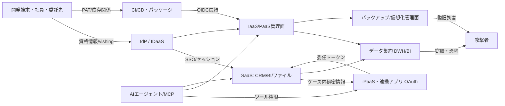

# サイバー攻撃の歴史的変遷（2020–2026）と2027–2030年脅威予測 — 調査報告書素材

調査実行日：2026年11月20日（JST）。読者想定：日本国内のITコンサルティング／AWSセキュリティ技術者。
表記規則：**【確認済み事実】**＝一次資料・被害組織・公的機関が確認／**【専門家分析】**＝調査会社の解釈／**【予測】**＝本調査の見通し。侵入経路が判明していないものは「不明」と明記する。海外事例を国内発生事実としては書かない。

## Summary（要旨）

1. 2020–2026年の変化の本質は「攻撃対象がオンプレミスからSaaSへ置き換わった」ことではなく、**正規の更新・管理権限・ID・委任トークンという『信頼関係』を経由する攻撃が、従来型の脆弱性悪用・ランサムウェアに上乗せされ、相互接続した**ことである。2026年時点でも初期侵入の最大手は脆弱性悪用（DBIR 2026：31%、M-Trends 2026：32%）であり、ID一辺倒の理解は誤り。
2. 「SaaS攻撃の増加」は統計で直接は測れていない。測れているのは**第三者関与の侵害割合の上昇（DBIR：15%→30%→48%）**であり、これは母集団拡大・分類変更の影響を含む。SaaS事業者侵害／顧客テナント侵害／連携アプリ侵害を分ければ、近年の大規模事例の多くは後二者である。
3. 攻撃者の経済合理性は「1回の侵害で多数のテナントに届く集約点（IdP、連携アプリ、CI/CD、復旧基盤）」と「正規APIで静かに大量取得できるデータ集約点」に向かう。防御優先度は発生確率ではなく、この波及構造で決めるべきである。
4. AIは攻撃の**速度と量**を既に変えた（国内でもAIペネトレーションツール悪用が観測済み）が、完全自律攻撃は未確立（GTG-1002でも人間の関与とモデルの幻覚が残った）。AIエージェント自体への攻撃（プロンプトインジェクション、MCP）は研究PoCが先行し、大規模な実被害の確認は限定的。
5. 日本国内の2025–2026年の実像は、海外型のSaaS連携攻撃よりも、**委託先アカウントのMFA例外（アスクル）、公開Web/API・BIツールの脆弱性（JPCERT/CC 2026年10月注意喚起）**が公表被害の中心であり、対策の主戦場もここにある。

---

## Findings

### 1. 過去の攻撃は何を狙い、どう進化してきたか — 年代別攻撃変遷表（素材）

| 年 | 事例 | 発生日／発覚・公表日 | 侵入経路 | 横展開・手法 | 被害 | 技術的特徴・分類 |
|---|---|---|---|---|---|---|
| 2020 | SolarWinds Orion サプライチェーン攻撃（SUNBURST）【確認済み】 | 悪性更新配布 2020年3–6月／発覚 2020-12-08（FireEye自己侵害調査）・公表 2020-12-13、CISA緊急指令21-01 | ビルド環境への侵入（SUNSPOTがコンパイル時にバックドア挿入）。攻撃者のSolarWinds内部への最初の侵入経路は完全には確定していない＝**一部不明** | 署名済み正規更新として配布。二次侵入は選別された少数組織のみ。SAMLトークン偽造等でクラウドへ | 悪性版をインストールしたのは18,000組織未満（SolarWinds 8-K）。米政府機関・大手企業が二次被害。2021-04-15 米政府がロシアSVRに帰属 | **事業者（ビルド基盤）侵害型**。信頼の起点＝ソフトウェア供給網 |
| 2021 | Kaseya VSA ランサムウェア（REvil）【確認済み】 | 攻撃 2021-07-02（米独立記念日週末）／同日公表、CISA/FBI共同ガイダンス 07-04 | オンプレミスVSAのゼロデイ群（CVE-2021-30116等。DIVDが2021年4月に報告し修正作業中だった） | VSA自体の正規ソフトウェア配布機能でMSP配下端末へランサムウェア一斉配信 | 直接侵害はKaseya顧客60未満（多くがMSP）、下流は1,500組織未満（Kaseya発表）。身代金要求は総額7,000万ドル提示。**KaseyaのSaaS版VSA自体は侵害されず**（予防的停止のみ） | **集中管理基盤の特権悪用型**。RaaSの分業モデル |
| 2022 | Okta／Sitel（LAPSUS$）【確認済み】 | 侵入 2022-01-16〜21／発覚は攻撃者のスクリーンショット公開 2022-03-22、Okta最終報告 2022-04-19 | 委託先Sitelのサポートエンジニア端末へのRDP遠隔アクセス（Sitel環境への侵入経路の詳細は限定的） | サポート用管理画面経由で顧客テナントへ到達可能な状態 | 当初「最大366顧客（約2.5%）が潜在的影響」→最終調査では**実際にアクセスされたのは2テナント、端末制御は1月21日の約25分**。潜在影響と実被害の乖離の典型例 | **ID事業者の委託先・サポート経路型**。Okta本番サービス自体は侵害されず |
| 2023 | MOVEit Transfer 大規模悪用（Cl0p）【確認済み】 | 大規模悪用開始 2023-05-27頃／Progress公表 2023-05-31、CISA KEV登録 06-02、FBI/CISA共同勧告 AA23-158A | CVE-2023-34362（未認証SQLインジェクション、CVSS 9.8）をゼロデイ悪用 | WebシェルLEMURLOOT設置→データ窃取のみ（暗号化なし）→リークサイトで恐喝 | Emsisoft集計（公表ベースの集計であり公式 census ではない）で2024年8月時点2,773組織・約9,580万人。多くはMOVEitを直接使わず、給与・福利厚生等の委託先経由で被害 | **データ集約製品の脆弱性悪用型**。MOVEitはオンプレ／ホスティング両形態があり「SaaS侵害」と一括りにできない |
| 2023 | （追加）Oktaサポートシステム侵害【確認済み】 | 不正アクセス 2023-09-28〜10-17／公表 2023-10-20 | 従業員の個人Googleアカウントに保存されていたサービスアカウント資格情報の窃取 | 顧客がアップロードしたHARファイル内のセッショントークンを窃取しセッションハイジャック | 134顧客のファイル閲覧、5顧客でセッション乗っ取り（1Password、BeyondTrust、Cloudflare等が自社側で先に検知）。本番IDサービスは侵害されず | 先行レポートが扱っていない重要事例。**サポート基盤＝トークンの集積場所**という教訓 |
| 2024 | Snowflake顧客環境への資格情報攻撃（UNC5537）【確認済み】 | キャンペーン開始 2024年4月／Snowflake警告 2024-05-31、Mandiant報告 2024-06-10 | インフォスティーラーで窃取された**顧客の**資格情報（最古は2020年11月の感染由来、最大4年未ローテーション）。悪用アカウントの79.7%に過去の漏えい歴 | 正規ログイン→データ窃取→恐喝／闇市場販売。FROSTBITE等の偵察ツール | 約165組織に通知。AT&T、Ticketmaster等が被害公表。**MandiantはSnowflake自社環境の侵害の証拠なしと明言**。被害アカウント共通点：MFAなし、資格情報未ローテーション、ネットワークポリシーなし | **顧客テナント侵害型**の代表例。「Snowflakeがハッキングされた」という報道表現は不正確 |
| 2025 | Salesloft Drift OAuth悪用（UNC6395）【確認済み】 | トークン悪用 2025-08-08〜18／GTIG公表 2025-08-26頃、拡大公表 08-28 | 前段として2025年3–6月にSalesloftのGitHubアカウントへ不正アクセス（**その侵入経路は未公表＝不明**）→DriftのAWS環境→顧客連携用OAuthトークン窃取 | 正規連携アプリとしてSalesforce API（SOQL偵察→Bulk API大量抽出）。主目的はCRMデータ自体より内部に埋め込まれたAWSキー（AKIA）、パスワード、Snowflakeトークン等の**秘密情報の収穫**。Drift Email連携のトークンで一部Google Workspaceメールにもアクセス | 700超の組織に影響とされる（FINRAアラート等）。Salesforceプラットフォーム自体の脆弱性は使われていない | **連携先（iPaaS的アプリ）侵害→顧客テナント波及型**。単一障害点の fan-out |
| 2025 | （追加）Gainsight連携悪用【確認済み／範囲は係争中】 | Salesforceが異常検知しトークン失効 2025-11-19〜20 | Gainsight発行アプリのOAuthトークン悪用。トークンはDrift侵害で流出したサポートケース内秘密情報由来と報じられ、**侵害の連鎖（cascade）**が示唆される | Driftと同様に正規API経由のデータ取得 | GTIGは200超のSalesforceインスタンスが潜在的影響と把握。一方Gainsight CEOは実際にデータ窃取されたのは少数と発言し、**被害範囲は確定していない** | 「侵害が次の侵害の入口になる」連鎖の実例として重要 |
| 2025 | （追加）Anthropic GTG-1002（AI統制型スパイ活動）【一次当事者報告／外部検証は限定的】 | 検知 2025年9月中旬／公表 2025-11-13 | Claude Codeを「正規のセキュリティ企業の社員」と偽るロールプレイ＋タスク細分化で脱獄 | AIが偵察、脆弱性調査・攻撃コード作成、資格情報収集、横展開、データ抽出、文書化まで実行。人間は標的選定と4–6箇所の判断点のみ | 約30組織を標的、成功は「少数」。AIが資格情報を幻覚する等の失敗も記録。独立研究者から規模・自律性への懐疑論あり | 第5節で詳述。「AI自律攻撃」の**観測済みだが単一当事者報告**の事例 |
| 2026 | ShinyHunters系SaaS OAuth攻撃の継続（Microsoft整理）【確認済み】 | 活動期間 2025年半ば〜2026年半ば／Microsoftブログ 2026-07-13 | 3経路：①音声フィッシングで悪性Connected AppへのOAuth同意を誘導 ②侵害ベンダー（Drift、Gainsight、2026年6月のKlue：4年放置された旧資格情報が入口とされる）のトークン窃取 ③Salesforce Experience Cloudゲストユーザーの過剰権限（Aura/GraphQL） | 正規APIワークフローに紛れるデータ抽出・恐喝。マルウェアもプラットフォーム脆弱性も使わない | 小売・教育・製造等、複数業種のSalesforceテナント。Klue経由では顧客195組織のトークンに到達したと報じられる | 2025年型攻撃が2026年も**再現され続けた**ことが重要。新規性より持続性 |
| 2026 | CI/CD→クラウド権限昇格（UNC6426、Google Cloud Threat Horizons H1 2026）【確認済み】 | 前段のNx npm侵害（s1ngularity）は2025年8月／報告書 2026年 | 侵害npmパッケージ経由で開発者のGitHub PAT窃取→Nord Stream等の正規ツールでCI/CD内秘密を抽出 | GitHub ActionsのOIDC信頼を悪用し過剰なCloudFormation権限から新規AWS管理者ロールを作成、**72時間未満でAWS完全管理者権限**へ。S3抽出、EC2/RDS終了、GitHubリポジトリ改名・公開化 | 個別被害組織名は報告書では匿名化 | **CI/CD基盤侵害→IaaS管理面**の完全な実証事例。先行レポートの仮説を裏付ける最強の実例の一つ |
| 2026 | 日本国内の連続不正アクセス（JPCERT/CC）【確認済み】 | 2026年9月前後から被害公表相次ぐ／注意喚起 2026-10-08（JPCERT-AT-2026-0030）、10-23更新 | ケースA：既知脆弱性の探索／設定ファイル・バックアップ窃取試行、B：スマホアプリ解析→APIエンドポイント・キー特定→内部API不正操作（権限変更、不正アカウント作成、NoSQLi等）、C：BIツールMetabaseのSQLi（CVE-2026-72898）、D：Webシェル（WAR/JSP）設置、E：**AIペネトレーションテスト基盤（Cairn、CyberStrikeAI、ARTEX等）の悪用** | 大量の個人情報漏えい。BIツールや従業員向け管理システム等「不特定多数向けでないシステム」も被害 | 国内公表は多数（報道集計では2026年10月上旬時点でWebシステム漏えい公表119件・うち81件が7月以降という民間集計あり＝**民間集計であり公式統計ではない**）。ローソンID約215万件、skyticket約1,464万件等の大型公表が報じられた | 国内の主戦場は現時点でSaaS連携ではなく**公開Web/APIと設定不備**。海外傾向の直輸入は誤り |

**進化の読み解き【専門家分析】**：(1) 2020–21年は「供給網と集中管理権限の一撃 fan-out」、(2) 2022–23年は「ID事業者周辺（委託・サポート）とデータ集約製品の脆弱性」、(3) 2024–25年は「顧客側ID／委任トークンの窃取と正規APIでの静かな大量取得」、(4) 2026年は「その複合＋AIによる探索の高速化」。ただし各年の従来型攻撃（VPN/エッジ脆弱性、ランサムウェア）は消えていない。M-Trends 2026でも初期侵入1位は6年連続で脆弱性悪用（32%）である。

### 2. SaaS関連の攻撃が目立つ理由 — 事業者／テナント／連携先の区別と統計検証

**厳密な4分類**（混同が原因分析を誤らせる）：
- **(a) SaaS事業者自体の侵害**：SolarWinds（ビルド基盤）、Salesloft（GitHub→Drift基盤）。事業者の鍵・トークン・運用基盤が盗まれる。
- **(b) 顧客テナントの侵害**：Snowflake 2024。事業者は侵害されておらず、顧客の資格情報・MFA未設定が原因。責任分界上は顧客側設定が主因（ただし事業者のデフォルト設計＝MFA任意、も寄与し、Snowflakeは後にMFAデフォルト化を進めた）。
- **(c) 連携先・第三者アプリの侵害**：Drift、Gainsight、Klue。顧客が正規に委任したOAuth権限が、連携先経由で横断的に悪用される。MFAをすり抜けるのではなく、MFAの**対象外**（認証後の委任トークン）である点が本質。
- **(d) SaaS/API自体の脆弱性悪用**：MOVEit（一部ホスティング形態）、国内Metabase事例。認証以前の欠陥。

**なぜ目立つのか【専門家分析】**：①規模の経済（一つの連携アプリが数百〜数千テナントと接続し、攻撃が一対多になる）②データ集中（CRM・サポートケースには認証情報まで埋め込まれ、Drift事例では秘密情報収穫が主目的だった）③検知困難性（正規API呼び出しはログインログに痕跡を残さず、Microsoftも「正規の連携動作と区別が困難」と明記）④責任分界の曖昧さ（事業者・顧客・連携先のどこが直すのか決まっていない組織が多い）⑤**公表・報道バイアス**（大手SaaS経由の被害は顧客各社が個別に公表義務を負うため、1件の侵害が数百件の「被害公表」に増幅される。MOVEitの2,773組織という数もこの構造で膨らむ）。

**統計的に本当に増えているのか — 検証結果**：
- 「SaaS攻撃の件数・割合」を時系列で直接示す公的統計は、調査した範囲では**存在しない**。DBIR、M-Trends、ENISAのいずれも「SaaS」という分類軸で初期侵入を集計していない。
- 代替指標であるDBIR「第三者関与」48%（2026年版）は、ソフトウェアサプライチェーン、データ保管ベンダー、接続ベンダー等を含む広い概念であり、**「SaaS攻撃48%」ではない**。しかも後述の通り母集団が前年の約2倍に拡大しており、上昇の一部はデータセット構成の変化で説明され得る。
- 一方で、質的証拠（Drift→Gainsight→Klueと同一手口が3回再現、Microsoftが1年分のキャンペーンとして整理、M-Trends 2026でクラウド侵害の初期経路1位が音声フィッシング23%）は、**連携・ID経由の手口が「実在し、再現性を持って使われている」**ことを強く示す。
- 結論：**「手口としての定着」は確認済み、「発生率の統計的増加」は未確認**。報告書ではこの2つを分けて書くべきである。

### 3. 現在の攻撃者が優先する技術的・経済的標的

攻撃者の意思決定は「コスト（初期アクセス取得単価）×成功確率×期待利益（データの換金性・恐喝の支払い確率）÷摘発リスク」で説明できる【専門家分析】。

| 変化 | 観測事実 | 経済的含意 |
|---|---|---|
| 初期アクセスの分業・高速化 | M-Trends 2026：初期アクセスから二次グループへの引き渡し中央値が2022年の8時間超→2025年**22秒**。ランサムウェア侵害では「prior compromise（購入済みアクセス）」が初期経路1位（30%） | アクセスは買うものになり、攻撃の限界コストが低下。防御側の検知窓は「日」ではなく「分」 |
| 脆弱性悪用の高速化 | DBIR 2026：脆弱性悪用が初期侵入31%で初の1位。KEV脆弱性の完全修正率は26%（前年38%）へ低下、修正中央値43日。GTIG：2026年1–8月の悪用観測141件が2025年通年127件を超過、増加の中心はゼロデイより**n-day** | 公開直後のn-dayを量産型に悪用する方が、ゼロデイ開発より安く確実。「パッチ適用能力」自体が攻撃者の収益源 |
| パスワード攻撃の相対的低下とトークンへの移行 | MDDR 2026：パスワード攻撃は前年比−26%（MFA・パスキーの効果）。一方AiTMフィッシング／トークン窃取の割合は2026年上半期に2倍超。M-Trends：メールフィッシングは2022年22%→2025年6%へ低下、音声フィッシングが11%で2位（クラウド侵害では23%） | MFA普及で「パスワードの価値」が下がり、価値は**セッション・OAuthトークン・ヘルプデスク経由の同意**へ移った。攻撃者は防御の進歩に適応している |
| 収益化の変化 | DBIR 2026：ランサムウェアは侵害の48%に存在するが、支払い拒否69%、支払い中央値は約14万ドルへ低下傾向。Drift型は暗号化せずデータ窃取・恐喝のみ | 暗号化だけでは稼げなくなり、**「静かな大量窃取＋公開恐喝」**と「復旧妨害で支払い圧力を上げる」二方向へ分化 |
| 標的の集約点化 | Akira／Qilin等がバックアップ基盤・ID基盤・仮想化管理面を暗号化前に狙う（M-Trends 2026）。国内アスクルでも同一DC内バックアップが暗号化された | 「止めると業務が止まり、戻せない」基盤ほど恐喝の交渉力が高い。復旧基盤は利益最大化の急所 |

**優先標的の整理**：技術的には (1) インターネット公開のエッジ／Web／APIと未修正脆弱性、(2) 人のID（ヘルプデスク・vishing）、(3) 非人間ID（OAuthトークン、サービスアカウント、CI/CDのOIDC信頼）、(4) データ集約SaaS、(5) 復旧・仮想化・IDの管理面。経済的には「1回の成功で複数組織・大量データ・復旧不能のいずれかが得られる場所」が優先される。

### 4. 今後どのXaaSや技術基盤が狙われやすいか — XaaS別リスク比較表（素材）

前提：SaaS/PaaS/IaaSは**クラウド提供モデル**の分類、IDaaS/iPaaS/AIaaS/DaaS/BaaS等は**機能別の通称**であり、相互排他的ではない（例：SnowflakeはPaaS的提供モデル＋DaaS的機能、OktaはSaaSとして提供されるIDaaS）。「BaaS」は文脈によりBackend-as-a-Serviceも指すため、本表ではBackup-as-a-Serviceと明記する。RaaS（Ransomware-as-a-Service）は攻撃者のビジネスモデルであり被害対象の分類ではない。

| 領域 | 役割 | 攻撃実績 | 典型侵入経路 | 狙われる理由 | 侵害時の影響範囲 | 2027–2030リスク変化【予測】 | 現実的な防御策 |
|---|---|---|---|---|---|---|---|
| SaaS（業務アプリ） | CRM、グループウェア、チケット、ファイル共有 | Drift/Gainsight/Klue経由のSalesforce被害、ShinyHunters系の継続活動 | 連携トークン窃取、vishingによる同意、ゲスト権限誤設定、自社テナントの資格情報 | データ集中、テナント数の多さ、APIでの大量取得容易性 | 自社テナントの全データ。連携先侵害時は全顧客テナントへ fan-out | 高止まり。件数より「1件あたり波及テナント数」が問題化 | Connected Apps棚卸し、スコープ最小化、管理者承認制、API量監視、ベンダー事故時のトークン即時失効手順 |
| PaaS | アプリ実行基盤、DB、コンテナ基盤 | MDDR 2026でデバイスコードフィッシングのルアーに正規PaaSが悪用と報告。個別大規模事例はIaaSと一体で語られることが多い | ワークロードID誤設定、公開管理面、脆弱なランタイム／ミドルウェア | 開発速度優先で権限が広くなりがち、環境変数・シークレットの集積 | アプリ単位からプロジェクト／サブスクリプション単位へ昇格可能 | 上昇。AIアプリ実行基盤（推論エンドポイント等）との融合で攻撃面拡大 | ワークロードIDの短期化・スコープ分離、シークレット管理、公開面の棚卸し |
| IaaS | VM、ネットワーク、ストレージ、IAM | UNC6426（OIDC悪用でAWS管理者化）、エッジ／VPN脆弱性の継続悪用 | IAM長期キー、過剰な信頼ポリシー、公開管理面、脆弱性 | 全ての土台であり、権限奪取＝全データ・全復旧手段への到達 | アカウント／組織全体。データ窃取・破壊・暗号資産マイニング等 | 高止まり（既存脅威の継続）。初期侵入の主因は当面こちら側の脆弱性・ID | SCP／境界ポリシー、長期キー廃止、CloudTrail等の異常検知（ロール新規作成等）、IMDSv2強制 |
| IDaaS | SSO、MFA、ディレクトリ（Entra ID、Okta等） | Okta 2022（委託先）、Okta 2023（サポート）、ヘルプデスクへのvishingでMFAリセットを狙う手口の一般化 | サポート／委託経路、セッショントークン窃取、AiTM、デバイスコードフィッシング | 全SaaSへの共通制御点。1つの侵害が全業務システムの鍵になる | 全連携SaaSへの同時侵入可能性 | **最優先で上昇**。パスワードレス化が進むほど攻撃はトークン・同意・ヘルプデスクへ集中 | フィッシング耐性MFA（FIDO2/パスキー）を管理者・ヘルプデスク手続に、デバイスコードフロー制限、トークン保護、サポート委託先の統制 |
| iPaaS／連携SaaS | ETL、ワークフロー、API連携、マーケ／CSツール | Drift、Gainsight、Klue（いずれも連携アプリ経由） | 連携先自体の侵害、長期リフレッシュトークン、過剰スコープ、Webhook | 「正規の連携」という免罪符と顧客横断の接続数 | 接続先SaaS横断のデータ取得 | **最優先で上昇**。連携数は企業のSaaS利用拡大とともに増え続ける | 連携レジストリ（所有者・スコープ・最終利用日）、未使用連携の削除、ベンダーのセキュリティ評価と事故時連携条項 |
| AIaaS | LLM API、AIゲートウェイ、RAG基盤 | LiteLLM／Langflow等のAIミドルウェア脆弱性の悪用観測（GTIG 2026）。大規模な顧客被害の確定事例は限定的 | APIキー窃取、公開推論エンドポイント、RAG経由の間接プロンプトインジェクション | APIキーが課金とデータの両方に直結。RAGは社内データへの新しい読み取り経路 | プロンプト／学習データ／接続先データの漏えい、課金被害 | 上昇（導入速度＞統制整備）。ただし実被害の統計的裏付けはまだ弱い | APIキーの分離・上限設定、RAGのアクセス制御を元データと一致させる、出力フィルタと監査ログ |
| DaaS（Data）／分析基盤 | DWH、BI、データ共有 | Snowflake 2024（テナント侵害）、国内Metabase SQLi（2026） | 資格情報、公開BI、SQLi、過剰なデータ共有設定 | データが最終的に集まる場所。窃取の「出口」として最適 | 大量・高機微データの一括流出 | 上昇。AI学習・分析需要で集約がさらに進む | MFA・ネットワークポリシー必須化、エクスポート量監視、BIツールの公開範囲とパッチ管理 |
| BaaS（Backup）／DRaaS | バックアップ、災害復旧、スナップショット管理 | ランサムウェア各グループによるバックアップ・仮想化管理面の先行破壊（M-Trends 2026）。アスクルで同一DC内バックアップ暗号化 | 管理者権限奪取、本番IDと共通の認証基盤 | 復旧不能化が支払い圧力を最大化する | 復旧不能＝業務停止の長期化（アスクルは全物流センター出荷再開まで約3.5か月） | 高止まり〜上昇。「暗号化」より「復旧妨害」が収益化の核に | 不変性（イミュータブル）、本番と独立した認証・アカウント、削除猶予、**復元テスト成功率**のKPI化 |
| SecaaS／MDR／MSP | 監視、運用代行、リモート管理 | Kaseya 2021（RMM経由）。セキュリティ製品自体の脆弱性悪用も継続 | RMM／管理ツールの脆弱性、共通管理者アカウント | 顧客横断の特権接続を持ち、侵害時は検知側を無力化できる | 全顧客への横展開、監視妨害 | 高止まり。委託拡大とともに構造的に残る | MSP接続のJIT化・録画・承認、顧客側でのMSP操作ログ監視、契約上の通知SLA |
| CI/CDクラウド開発基盤 | ソース管理、ビルド、デプロイ（GitHub Actions等） | UNC6426（Nx→PAT→OIDC→AWS管理者）、s1ngularity | 依存パッケージ侵害、PAT窃取、OIDC信頼の過剰権限、シークレット漏えい（DBIR：GitHub上の漏えいシークレット修正中央値94日＝2025年版） | ビルド権限は本番デプロイ権限に直結。開発端末は統制が緩い | ソフトウェア供給網全体＋クラウド管理面 | **上昇**。AIコーディング普及でパッケージ・拡張機能の取り込みが加速 | OIDCロールの最小権限（特にロール作成権限の分離）、PAT短期化、postinstall実行のサンドボックス、依存関係の固定と検証 |
| AIエージェント／MCP接続基盤 | エージェント、ツール／MCPサーバー、ゲートウェイ | 研究PoC中心（第5節）。実被害の大規模確定事例は2026-11-20時点で限定的 | 間接プロンプトインジェクション、ツールポイズニング、悪性MCPサーバー、過剰なツール権限 | エージェントは「人間の権限＋機械の速度＋外部コンテンツの読解」を併せ持つ新しい委任主体 | 保有API権限の範囲でデータ取得・送信・設定変更が自動実行され得る | **不確実性最大の上昇領域**。導入が統制に先行すれば2028年頃に初の大型事例が出てもおかしくないが、断定はできない | ツール権限の分離、高影響操作への人間承認、外部コンテンツと命令の分離、MCPサーバーの出所検証・棚卸し、エージェント用IDの分離と監査 |

### 5. AI普及が攻撃者と防御側双方に与える影響 — 観測／PoC／予測の分離

| 区分 | 事例・知見 | 内容と限界 |
|---|---|---|
| **観測済み（実攻撃）** | Anthropic GTG-1002（2025-11公表） | AIが戦術作業の80–90%を実行したとAnthropicが報告。ただし**単一当事者の報告**であり、標的名・被害詳細は非公表、成功は少数、モデルの幻覚（存在しない資格情報の主張）が自律性の限界として明記された。研究者からの懐疑論も存在する。「完全自律攻撃が実現した」と書くのは過剰 |
| **観測済み（実攻撃）** | JPCERT/CC ケースE（2026-10） | 国内でAIペネトレーションテスト基盤（Cairn、CyberStrikeAI、ARTEX等）を悪用した脆弱性探索・攻撃試行を確認。これは「AIエージェントが自律的に企業を攻略した」話ではなく、**人間がAI搭載の攻撃ツールを使った**事例として正確に分類すべき |
| **観測済み（実攻撃）** | QUIETVAULT／Nx事例（Google Threat Horizons H1 2026） | 侵害パッケージ内の資格情報窃取ツールが、被害端末に既に存在するLLMを使って設定ファイル（.env等）を列挙・棚卸しした。マルウェアへのAI組み込みの初期実例 |
| **観測済み（統計）** | GTIG「AI時代の脆弱性発見と悪用動向」（2026-09-30公表） | 月次CVE公表数が2026年1月5,045件→8月ピーク10,740件に倍増。AIが発見したとされる脆弱性はRCE比率50%（全体26%）。ただしGTIG自身が「AI帰属の標準メタデータがなく過小評価」「自動CVE採番による水増し（Linux Kernel約5,000件等）」を注意喚起。**公表数の増加＝悪用可能な脆弱性の増加ではない**（悪用観測は全体の0.23%） |
| **観測済み（統計）** | DBIR 2026のAI分析（Anthropic協力） | 執行措置を受けた793の脅威アクターを分析し、AI支援を受けた攻撃手法の中央値15テクニック、AI支援の初期侵入はフィッシング関連44%・脆弱性悪用関連32%とされる（二次情報経由の数値であり、原典での再確認が望ましい） |
| **研究PoC** | EchoLeak（CVE-2025-32711、Aim Security、2025-06） | M365 Copilotへのゼロクリック間接プロンプトインジェクションでデータ抽出を実証。Microsoftはサーバー側で修正し、**実環境での悪用は確認されていない**。攻撃ではなく脆弱性研究 |
| **研究PoC** | MCPの安全性研究（arXiv:2601.17549、CSAリサーチノート等、2025–2026） | ツールポイズニング、クロスサーバー・シャドーイング、STDIOトランスポート経由のRCE、認証任意仕様による無認証公開インスタンス（2025年7月スキャンで1,862件との報告）等が指摘される。多くは設計・実装上の欠陥の指摘と実験であり、**MCPサーバー侵害による大規模実被害は未確認** |
| **研究PoC** | LLMエージェントの脆弱性悪用実験 | CVE説明文を与えたGPT-4エージェントが1-day脆弱性15件中87%を悪用できたとする先行研究（2024）等。実験環境の成績であり、実環境の防御・権限・検知がある条件とは異なる |
| **防御側の進歩【確認済み／専門家分析】** | AI支援検知・対応 | MDDR 2026はAIによる攻撃の高速化と同時に、防御側のAI活用（検知の自動化、調査支援）を前提に「攻撃者が先行して利益を得ている局面」と評価。Google Cloud VRPでは自動化で報告総数は急増したが**有効な報告数は18か月安定**しており、「AIで脆弱性発見が無限に増える」という単純な図式は成り立たない。フィッシング訓練・SOCトリアージ・パッチ優先付け（KEV＋悪用観測）での実務効果が先行 |
| **予測** | フィッシング高度化 | 音声・動画の生成AIによるvishingは既に観測され（Teams vishing +502%＝MDDR 2026）、今後も「人への攻撃」の単価が下がる方向は確度が高い |
| **予測** | 自律的攻撃エージェント | 偵察・初期侵入の自動化は2027年までにさらに進むが、権限昇格・業務文脈の判断・防御回避の適応では人間の介在が残るという見方が、GTG-1002の失敗事例からも支持される。完全無人・大規模・高成功率の同時成立は2030年でも不確実 |

**要点**：AIの確実な影響は「新しい攻撃カテゴリの創出」よりも先に「既存攻撃（探索、フィッシング、n-day悪用、資格情報の棚卸し）の**速度・量・単価**の変化」として現れている。防御側も同じ土俵（自動検知・自動封じ込め）で応じなければ、22秒ハンドオフのような時間軸では人間中心のSOCが構造的に間に合わない。

### 6. 日本国内の組織が優先すべき防御

**国内の実像（海外傾向との関係）**：
- IPA「情報セキュリティ10大脅威 2026」（2026-01-29公表、組織向け）：1位ランサム攻撃、2位サプライチェーンや委託先を狙った攻撃、3位**AIの利用をめぐるサイバーリスク（初選出）**、4位システムの脆弱性を悪用した攻撃。順位は専門家の投票によるもので発生統計ではない点に注意。
- アスクル（2025）：侵入口は**例外的にMFAを適用していなかった業務委託先向け管理者アカウント**（同社第13報、2025-12-12）とされ、初侵入は2025-06-05、発覚・停止は10-19。同一DC内のバックアップも暗号化され、物流子会社経由で無印良品・ロフト等のECも停止。全物流センターの出荷再開完了は2026-02-04。国内でも「委託先アカウント＋復旧基盤」が最大の教訓であり、海外のID/OAuth傾向と**根は同じ（委任された特権）だが経路はVPN／管理者アカウント型**だった。警察庁統計では2025年の国内ランサムウェア被害226件、侵入経路はVPN機器が6割超との整理がある（JNSA解説経由）。
- JPCERT/CC 2026年10月の一連の注意喚起：国内の大量漏えいはSaaS連携ではなく、**公開Web/API（アプリ解析、認可不備、レート制限なし）、BIツール、既知脆弱性、Webシェル**が中心。個人情報保護委員会も管理対象外APIの認可不備事例を警告。AWS/Azure利用組織でも、マネージドサービスの前に「自社が公開しているAPIとBI」が実際の弱点になっている。

**AWS環境を中心とした優先順位（P0→P2）**：
- **P0（即時）**：①全管理者・委託先アカウントのMFA例外の洗い出しと廃止（アスクル型の再現防止）。フィッシング耐性MFAを特権者に。②インターネット公開資産（Web/API、BI、VPN／エッジ、WSUS等）の棚卸しとKEV優先パッチ。JPCERT注意喚起対象の確認。③バックアップの分離検証：本番IAMと独立した認証・別アカウント、イミュータブル保管、削除猶予、そして**復元テストの実施**。④SaaS／iPaaS／CI/CDの非人間ID棚卸し：OAuth連携アプリ、サービスプリンシパル、GitHub Actions OIDCロール、長期アクセスキーの所有者・スコープ・最終利用日を記録し、未使用を削除。
- **P1（四半期）**：⑤ログ統合と検知：IdP認証、OAuth同意、SaaS API操作、CloudTrail（特にIAMロール新規作成・ポリシー変更）、CI/CDログをアプリID／トークン単位で相関。バルクエクスポートと異常なAPI量をアラート化（Drift型はログインログに出ない）。⑥APIセキュリティ：全エンドポイント（非公開含む）での認可、レート制限、連番ID対策、アプリへの秘密情報埋め込み禁止（OWASP API Security参照、JPCERT推奨と同一）。⑦委託先管理：事故通知SLA、トークン失効手段、サブプロセッサー、フォレンジック証跡の保全を契約に明記。責任分界（事業者／顧客／連携先）をサービスごとに文書化。
- **P2（半年〜）**：⑧短期トークン化・JIT権限への移行、OIDCロールの最小権限（ロール作成権限の分離）。⑨AIエージェント導入時の統制：ツール権限分離、高影響操作の人間承認、外部コンテンツを命令として扱わない設計、エージェント専用IDと監査。⑩演習：「連携アプリのトークン漏えい」「CI/CD→AWS管理権限奪取」「バックアップ削除」の3シナリオを個別に実施。

### 定量分析（2020–2026）— 報告書間の非互換性に注意

各報告書は調査対象・定義・母集団・期間が異なる。**数値を報告書間で単純に接続して「推移」としない**こと。以下は各報告書内での前年比較に限定した整理である。

| 指標 | 出典 | 数値の動き | 読み方の注意 |
|---|---|---|---|
| 第三者関与の侵害割合 | Verizon DBIR 2024→2025→2026年版 | 15%→30%→48% | 2026年版の母集団は侵害22,625件（前年版12,195件）とほぼ倍増し、パートナー構成も変わる。実世界の発生率が3倍になった証拠ではない。分類変更（2026年版では初期侵入にPretexting新設、資格情報悪用は定義調整で16%相当とも）の影響もある |
| 脆弱性悪用の初期侵入割合 | DBIR | 2023年版 約5%→14%→20%→31%（2026年版） | 「既知の初期侵入がある侵害」が分母（2026年版 n=19,905）。MOVEit年（2023）以降の上昇は一貫 |
| 資格情報悪用の初期侵入割合 | DBIR | 22%（2025年版）→13%（2026年版） | ただし攻撃チェーン全体では39%の侵害に資格情報悪用が登場（2026年版）。「初期侵入での順位低下」と「重要性の低下」は別 |
| ランサムウェアの存在割合 | DBIR | 32%→44%→48% | 「侵害の中でランサムウェアが要素として存在」の割合。支払い中央値は低下（15万→11.5万→約14万ドルと年により変動）、拒否率は上昇 |
| 初期侵入ベクトル | Mandiant M-Trends | 脆弱性悪用が6年連続1位（2025年調査32%）。メールフィッシング22%（2022）→6%（2025）、音声フィッシング11%で2位に浮上 | 母集団はMandiantが対応した標的型侵害のみ。一般的な侵害統計ではない。滞留期間中央値14日（2024年11日）へ上昇（スパイ・北朝鮮IT労働者事案が押し上げ） |
| 侵入経路 | ENISA Threat Landscape 2025 | フィッシング約60%、脆弱性悪用21.3%（侵入経路ベース）。全インシデントではDDoS 76.7% | EU域内・オープンソース中心の4,875件。DDoSを含むため他統計と分母が全く違う。2026年版は対象期間・方法を変更し単純比較不可とENISA自身が位置付け |
| クラウド侵害 | Google Cloud Threat Horizons H1 2026／M-Trends 2026 | ID侵害がクラウド侵入の83%に関与（Google、二次要約経由）。クラウド侵害の初期経路は音声フィッシング23%、第三者侵害17%、窃取資格情報16%（M-Trends） | 「ID関与83%」と「初期侵入の内訳」は別の測り方。前者はチェーン全体、後者は入口 |
| 国内ランサムウェア | 警察庁統計（JNSA解説経由） | 2025年被害226件、侵入経路はVPN機器が6割超 | 警察への報告ベース。国内の実像は依然としてネットワーク機器経由が中心であり、世界のSaaS傾向と異なる |
| API／OAuth連携基盤攻撃の推移 | — | **時系列統計は確認できず** | Drift（2025）、Gainsight（2025）、Klue（2026）等の事例の蓄積はあるが、母集団のある統計は存在しない。件数の増加を主張する場合は事例ベースであることを明記すること |
| サプライチェーン攻撃の推移 | — | DBIR第三者関与が最も近い代替指標 | 「サプライチェーン攻撃」自体の統一定義・時系列統計は存在しない |

### 先行レポートの独立検証

対象：https://github.com/aramakitomohiro/blog/blob/master/security/cyberattack-trends-xaas-2026-11-20.md（2026-11-20、全文を実際に読んで検証）

**中心仮説の評価**：「今後の主戦場は個々のSaaSから別XaaSへの単純移行ではなく、ID・API・OAuth・CI/CD・AIエージェントを介したサービス間の信頼関係になる」——**方向性は支持できる【専門家分析として妥当】**。根拠：Drift→Gainsight→Klueの再現性、UNC6426のCI/CD→OIDC→AWS管理者化、MicrosoftのShinyHunters整理はいずれも「ノードではなく委任関係（矢印）が攻撃された」事例であり、仮説と整合する。ただし以下の留保が必要。

**検証で確認できた点（正確）**：
- DBIR数値（第三者15%→30%→48%、脆弱性悪用31%、資格情報悪用13%、ランサムウェア48%）はVerizon原典（2026年版PDF）と一致。
- Snowflake＝顧客テナント侵害、Drift＝連携トークン悪用という区別はMandiant／GTIG原典と一致。
- JPCERT/CC 2026年10月の注意喚起（at260030）および調査記事の存在・内容（アプリ解析→API、AI利用の痕跡）は原典で確認。
- Microsoft ShinyHuntersブログ（2026-07-13）、Google Cloud Threat Horizons H1 2026、M-Trends 2026、IPA 10大脅威2026の順位（1位ランサム、2位サプライチェーン）は実在し内容も概ね正確。
- 「48%はSaaS攻撃の意味ではない」「公表件数増＝発生率増とは限らない」という注意書きは適切で、本検証でも同意。

**誤り・不正確・要修正点**：
1. **GTIG「AI時代の脆弱性」レポートの日付**：先行レポートは「2026-10」とするが、実際の公表は**2026-09-30**（報道は10-01開始）。軽微だが一次資料の日付としては不正確。
2. **DBIR資格情報悪用13%の定義変更の欠落**：2026年版では初期侵入カテゴリにPretextingが新設され、定義を揃えると16%相当ともされる。また攻撃チェーン全体では39%に資格情報悪用が登場する。13%だけを引くと「資格情報の重要性が半減した」という誤読を招く。先行レポートはこの留保を書いていない。
3. **第三者関与15%→30%→48%の解釈**：先行レポートは「母集団・定義の違いによる制約」に触れるが、それでも見出しでは「定量的裏付けは第三者関与の増加」と断定調である。2026年版は母集団が前年の約2倍（侵害12,195→22,625件）に拡大しており、**上昇幅のかなりの部分がデータセット拡大・分類変更で説明可能**である点はもっと強く書くべき。「裏付け」ではなく「整合するが証明にはならない」が正確。
4. **Okta 2022の被害規模の省略**：366は「潜在的影響の上限」であり、最終調査では実アクセスは2テナント・制御25分。先行レポートの時系列表はこの落差に触れず、読者が366テナント侵害と誤読し得る。
5. **重要事例の欠落**：(a) Okta 2023年サポート侵害（HARトークン）——IDaaSリスクを論じるなら2022年事例より示唆が大きい。(b) Anthropic GTG-1002（2025-11）——AI自律攻撃の初の観測事例を欠き、AI節がOWASPフレームワーク（専門家の整理＝予測寄り）に依存している。(c) Gainsight（2025-11）とKlue（2026-06）——Drift型の再現・連鎖を示す最重要の続報が時系列にない（Microsoft 2026年ブログの引用に内包されるのみ）。(d) EchoLeak——プロンプトインジェクションの代表PoCの欠落。
6. **予測の射程**：先行レポートの予測は2027–2028年のみで、シナリオ分岐（抑制条件・反証条件）が弱い。本調査の依頼範囲である2030年・3シナリオには対応していない（先行レポートの誤りではなく範囲の差）。
7. **JPCERT「AI利用の痕跡」の読み**：ケースEは「AIペネトレーションテスト基盤の悪用」であり、攻撃者が生成AI一般を使ったというより**既製のAI攻撃ツールの使用**である。先行レポートの表現は概ね正確だが、この区別は明示すべき。
8. **反証可能性**：先行レポート第7節の反証可能な監視仮説（H1–H4）は良い設計であり、本検証でも枠組みとして採用可能。ただしH1の「目立つ」は測定方法（同一事件を1件と数える分類ルール）への依存が大きく、公表ベースでは検証が難しいという限界がある。

**総評**：先行レポートは一次資料志向で概ね信頼できるが、**「信頼関係が主戦場」という仮説自体は、初期侵入統計の最大手が依然として脆弱性悪用である事実と緊張関係にある**。正確な言い換えは「主戦場が移った」ではなく「**被害の波及範囲を決めるのは信頼関係であり、侵入の入口は脆弱性・人・IDに分散したまま**」である。この修正を加えれば仮説は反証可能な形で維持できる。

### 将来予測：2027／2028／2030 × 3シナリオ（素材）

前提：「増加予測（発生の見通し）」と「防御優先度（波及範囲×対策可能性で決める）」は別概念。以下は確率の断定ではなく、条件付きシナリオである。

| 時点 | ベースシナリオ | 高リスクシナリオ | 抑制シナリオ |
|---|---|---|---|
| **2027** | Drift型（連携トークン悪用）が年数件規模で再現。初期侵入は脆弱性悪用とID系が拮抗。AIは探索・フィッシングの高速化に留まり、自律攻撃は国家型スパイの実験的運用が中心。国内はWeb/API・VPN経由が公表被害の中心のまま | 大手iPaaS／IDaaSの連携基盤で単一障害点型の大規模fan-outが発生し、金融・医療含む数百組織が同時公表。n-day悪用の窓がさらに短縮し、KEV修正率の低下と相まって被害が拡大 | FIDO2／パスキーとトークン保護（送信者制約付きトークン等）の普及、SaaS側の連携ガバナンス標準化（Connected App承認制のデフォルト化）でDrift型の成功率が低下 |
| **2028** | AIエージェント導入が業務SaaSに本格化し、エージェント保有権限を巡る初の大型公表事例（プロンプトインジェクションまたはツール権限悪用）が発生。CI/CD・OIDC経由のクラウド侵害が「既知の型」として定着 | 悪性／侵害MCPサーバーやAIゲートウェイを起点に、複数顧客のエージェントが連鎖的に越権操作。攻撃側エージェントが偵察〜初期侵入〜窃取をほぼ無人で回し、検知側の自動化が追いつかない業種で被害集中 | エージェント用IDの標準化（権限分離、人間承認の必須化、MCPサーバーの署名・検証）が進み、エージェント経由被害はPoC水準に抑制。OWASP Agentic等の枠組みが調達要件化 |
| **2030** | 攻撃の中心は依然「脆弱性・ID・委任」の複合。ただし侵害の平均波及範囲は、連携と自動化の深化により2026年比で拡大。防御は自動封じ込めが前提の設計へ移行 | 攻撃エージェントの自律性が上がり、n-day悪用・ID攻撃・エージェント悪用を動的に組み替える適応型キャンペーンが一般化。復旧基盤・ID基盤への攻撃で「復旧できない侵害」が社会インフラ級で発生 | 短期トークン・継続的検証（CAEP等のリアルタイム失効共有）・不変バックアップが標準装備化し、単一侵害のfan-outが構造的に限定。攻撃者は統制の弱い中小・新興国市場へ移行 |

**各予測の根拠と反証条件（要点）**：
- 技術的根拠：トークン／委任攻撃の再現性（2025–2026に3回）、OIDC信頼の悪用実証、AI探索ツールの国内観測。／経済合理性：集約点への攻撃は限界コストが低く、防御側の修正能力（KEV修正率26%）が追いついていない。／連続性：いずれも新規の発明ではなく既存手口の延長。／障害：プラットフォーム側のデフォルト安全化（MFAデフォルト化の前例）、法執行（REvil、LockBitへの措置が実際に活動を縮小させた前例）、トークン送信者制約の標準化。／**予測が誤りと判断できる条件**：①2027年末時点でDBIR／M-Trendsの初期侵入に占める連携・トークン系の言及が消える、②Drift型の再現が2年以上途絶える、③AIエージェント経由の公表被害が2028年末までゼロで、かつエージェント導入が拡大している（＝統制が先行した証拠）、④国内公表被害でSaaS連携起因がWeb/API起因を上回る（＝国内ベースシナリオの誤り）。

### 攻撃経路アーキテクチャ図（Mermaid素材）

要点：防御対象はノードではなく矢印（委任・権限継承・信頼ポリシー）。各矢印に「誰が・何の権限で・どれだけの量を・いつまで」使えるかの統制を置く。

### 防御対策の優先順位（総括表）

| 順位 | 対策 | 対応する実績ある脅威 |
|---|---|---|
| 1 | 公開資産の脆弱性管理（KEV優先、エッジ/BI/API） | DBIR初期侵入1位31%、国内2026年連続漏えい |
| 2 | 特権・委託先IDのMFA例外廃止＋フィッシング耐性MFA | アスクル、Snowflake、vishing急増 |
| 3 | 非人間ID（OAuth/サービスアカウント/OIDC）の棚卸し・最小権限・短期化 | Drift、Gainsight、UNC6426 |
| 4 | バックアップの分離・不変化・復元テスト | Akira/Qilinの復旧妨害、アスクルの長期停止 |
| 5 | SaaS API操作ログの監視（バルク抽出検知） | 正規API型の静かな窃取全般 |
| 6 | API認可・レート制限・アプリ内秘密排除 | JPCERTケースB、PPC警告事例 |
| 7 | AIエージェント/MCPの権限分離と人間承認 | EchoLeak型PoC、エージェント普及への先行統制 |

### 最も確度の高い結論5項目
1. 初期侵入の最大手は2026年時点で脆弱性悪用であり（DBIR 31%、M-Trends 32%で独立に一致）、ID対策だけへの資源集中は誤り。
2. 大規模SaaS関連被害の主因は「SaaS事業者本体の陥落」ではなく、顧客テナントの認証不備と連携アプリの委任トークンであり、対策責任の所在が事例ごとに異なる（Snowflake／Driftの対比で確立）。
3. 第三者・連携経由の波及（fan-out）は再現性のある実在の型であり（2025–2026に少なくとも3回再現）、1件の侵害が数百組織の公表に増幅される構造がある。
4. AIの確実な効果は既存攻撃の高速化・大量化であり（国内観測、GTIG統計、GTG-1002）、完全自律攻撃の一般化は未確認。
5. 日本国内の公表被害の中心は現時点で公開Web/API・ネットワーク機器・委託先アカウントであり、海外のSaaS傾向をそのまま国内対策の優先順位にできない（JPCERT、警察庁、IPAの一致した示唆）。

### 追加調査が必要な論点5項目
1. 「SaaS／連携基盤攻撃」の母集団統計の不在を埋める方法（保険・IR各社の横断データ、SSPMベンダーのテレメトリの学術的検証可能性）。
2. DBIR第三者関与48%の内訳（サプライチェーン／データ保管／接続の各archetypeの比率と前年比較可能性）の原典精査。
3. GTG-1002の独立検証（標的組織の公表、他社テレメトリでの裏付け）と、Anthropic 2026年9月の続報キャンペーンの詳細。
4. MCP／AIエージェントの実被害の有無の継続監視（CVE化された実装欠陥と、実際の侵害事例の切り分け）。
5. 国内2026年連続漏えいの個別事案の侵入経路の確定状況（多くが調査中であり、JPCERTの類型と個別事案の対応付けは未確定）。

## Could not verify
- DBIR 2026のAI関連数値（793アクター、15テクニック等）は二次情報経由であり、原典PDFの該当章を直接精読できていない。
- Google Threat Horizons H1 2026の「ID関与83%」は二次要約経由。原典PDFの定義（分母・期間）の直接確認は未了。
- アスクルの侵入経路・流出件数は同社公表（第13報）を報じた二次情報経由。同社特設ページ原典の直接精読は未了（数値は「同社公表として報じられた範囲」と明記）。
- SalesloftのGitHub侵入の初期経路は、Salesloft／Mandiantとも未公表（＝不明が正しい記述）。
- Gainsightの実被害範囲はGTIG把握（200超の潜在影響）とGainsight側発言（実窃取は少数）で食い違い、未確定。
- 「SaaS攻撃の発生率の時系列統計」は調査範囲で存在を確認できなかった（不在の証明ではなく、主要統計に分類軸がないことの確認に留まる）。

## Sources（一次情報を優先、確認日はいずれも2026-11-20）
- 先行レポート（検証対象、一次情報として扱わない）: https://github.com/aramakitomohiro/blog/blob/master/security/cyberattack-trends-xaas-2026-11-20.md
- Verizon, 2026 DBIR（PDF）: https://www.verizon.com/business/resources/T457/reports/2026-dbir-data-breach-investigations-report.pdf
- Verizon, 2025 DBIR（抜粋PDF）: https://www.verizon.com/business/resources/infographics/2025-dbir-manufacturing-snapshot.pdf
- Mandiant/Google, M-Trends 2026 Executive Edition: https://services.google.com/fh/files/misc/m-trends-2026-executive-edition-en.pdf
- Google Cloud, Cloud Threat Horizons Report H1 2026: https://services.google.com/fh/files/misc/cloud_threat_horizons_report_h12026.pdf
- GTIG, Widespread Data Theft Targets Salesforce Instances via Salesloft Drift: https://cloud.google.com/blog/topics/threat-intelligence/data-theft-salesforce-instances-via-salesloft-drift
- Mandiant/Google, UNC5537 Targets Snowflake Customer Instances（2024-06-10、Google Cloud Blog）
- Microsoft Security Blog, Defending SaaS-based applications against ShinyHunters OAuth abuse（2026-07-13）: https://www.microsoft.com/en-us/security/blog/2026/07/13/defending-saas-based-applications-against-shinyhunters-oauth-abuse/
- Microsoft, Digital Defense Report 2026（2026-10-01、対象期間2025-07〜2026-06）
- GTIG, Vulnerability Discovery and Exploitation Trends in the AI Era（2026-09-30）: https://cloud.google.com/blog/topics/threat-intelligence/vulnerability-discovery-and-exploitation-trends-in-the-ai-era
- Anthropic, Disrupting the first reported AI-orchestrated cyber espionage campaign（2025-11-13）
- Okta, Okta's Investigation of the January 2022 Compromise: https://www.okta.com/blog/2022/03/oktas-investigation-of-the-january-2022-compromise/
- CISA, SolarWinds関連 Emergency Directive 21-01／AA20-352A；Kaseya VSA攻撃に関するCISA/FBIガイダンス（2021-07）；MOVEit／CL0P共同勧告 AA23-158A
- JPCERT/CC, 直近で相次いでいる国内組織における不正アクセスに関する注意喚起（JPCERT-AT-2026-0030、2026-10-08公開・10-23更新、verified live）: https://www.jpcert.or.jp/at/2026/at260030.html
- JPCERT/CC Eyes, 連続不正アクセス事案の攻撃手法に関する調査（2026-10-15）: https://blogs.jpcert.or.jp/ja/2026/10/web_api_attacks.html
- IPA, 情報セキュリティ10大脅威 2026（2026-01-29）: https://www.ipa.go.jp/security/10threats/10threats2026.html
- ENISA, Threat Landscape 2025（2025-10-01、対象2024-07〜2025-06、4,875件）
- Aim Security, EchoLeak（CVE-2025-32711）研究公表（2025-06）／Microsoft MSRCアドバイザリ
- Cloud Security Alliance, MCP Security Crisis リサーチノート（2026-05）: https://labs.cloudsecurityalliance.org/research/csa-research-note-mcp-security-crisis-20260504-csa-styled/
- FINRA, Cybersecurity Alert – Salesloft Drift AI Supply Chain Attack: https://www.finra.org/rules-guidance/guidance/salesloft-drift-AI-supply-chain-attack
