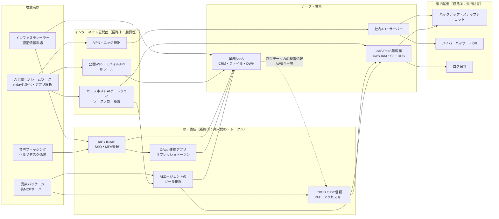

# サイバー攻撃の歴史的変遷（2020〜2026年）と2027〜2030年の脅威予測 ― 一次情報による独立検証版

- **調査実行日**：2026年11月20日（JST）
- **対象期間**：2020年1月〜2026年11月20日（観測）／2027・2028・2030年（予測）
- **想定読者**：ITコンサルタント、クラウドエンジニア（特にAWS）、セキュリティ担当者
- **位置づけ**：先行AIレポート（`security/cyberattack-trends-xaas-2026-11-20.md`）を一次情報として扱わず、その事実・数値・論理・予測を独立に検証したもの

> **表記ルール（全章共通）**
> - **【事実】**：公的機関・調査機関・被害組織の一次資料で確認できた事実（出典IDを付記）
> - **【分析】**：一次資料を発行した専門家・機関自身の分析、またはそれを比較した因果的解釈（どちらかを明記）
> - **【予測】**：本レポート（AI）による将来予測。統計的確率ではない
> - **未確認**：本調査で一次資料を確認できなかった情報／**不明**：被害組織が侵入経路等を公表していない
> - 出典IDは `[P01]` 形式。URL・資料名・公表日は第13章に一覧化
> - 日付はとくに断りがない限り資料に記載された日付（海外資料は現地表記のまま）

---

## 1. エグゼクティブサマリー

### 1.1 結論（先に要点）

1. **「SaaSが狙われるようになった」は半分正しく、半分は誤解を招く。** 2024〜2026年に目立った大型事案（Snowflake顧客環境、Salesloft Drift、Gainsight、Klue）は、いずれも**SaaS事業者の基盤そのものではなく、顧客テナントへの“正規の入口”（盗まれたパスワード、OAuthトークン、連携アプリ）**を悪用したものだった【事実】[P16][P19][P20][P22]。一方で、日本の2026年9〜11月の大量漏えい事案群の主因としてJPCERT/CCが整理したのは、**公開アプリの解析→バックエンドAPIの認可不備・既知脆弱性の悪用**であり、SaaS連携の悪用ではない【事実】[P42][P43][P44]。
2. **2025年データでは「脆弱性悪用」が再び最大の初期侵入経路になった。** Verizon DBIR 2026で31%（資格情報悪用13%、定義変更前の比較値で16%）[P31][P32]、Mandiant M-Trends 2026で32%（6年連続1位）[P33]、Google Cloud環境ではサードパーティ製ソフトの悪用が44.5%で資格情報を初めて上回った[P35]。**ただし資格情報悪用は侵入チェーンのどこかで39%の侵害に出現**し、依然として最も遍在する手口である[P32]。
3. **攻撃者の収益モデルは「暗号化」から「窃取＋恐喝」と「復旧妨害」に二極化した。** クラウド／SaaS関連インシデントの73%がデータを標的とし、ランサムウェアは3%にすぎない（Mandiant IR、2025年下半期）[P35]。一方オンプレ・仮想基盤では、ランサムウェア集団がバックアップ・ID基盤・ハイパーバイザー管理面を狙う「復旧拒否」が体系化した[P33]。日本でもアスクル事案でバックアップファイルの削除が確認されている[P46]。
4. **AIは2026年に「補助」から「部分的自律」へ段階が変わった。ただし成果の大半はn-day（既知脆弱性）の高速兵器化であり、未知の攻撃手法の創出ではない。** GTIGは2026年11月、人手を介さずパッチ差分から脆弱性を特定し攻撃まで実行するフレームワークを初めて観測したと報告[P37]。JPCERT/CCも国内向け攻撃でAIペネトレーションテスト基盤の悪用を確認した[P42]。同時に、AIゲートウェイ（LiteLLM）・ワークフロー基盤（Langflow、n8n）の脆弱性がCISA KEVに相次いで登録され、**「AIを使った攻撃」と並んで「AI基盤そのものへの攻撃」が実在化**した【事実】[P40]。
5. **2027〜2030年の主戦場は「単一のXaaS」ではなく、①インターネット公開面（Web/API/エッジ機器/AIゲートウェイ）の高速悪用と、②非人間ID（トークン・鍵・ワークロードID・エージェント権限）の窃取・委任悪用、の二本立てになる、というのが本レポートの予測**【予測】。先行レポートの「サービス間の信頼関係が主戦場」という仮説は②については強く支持されるが、①（とくに日本の観測事実）を相対的に過小評価しており、**単独の中心仮説としては反証される部分がある**（第11章）。

### 1.2 6つの問いへの短答

| 問い | 短答（区分） |
|---|---|
| ① 過去の攻撃は何を狙い、どう進化したか | 2020〜21年は「ソフト供給網・遠隔管理ツール」→2022〜23年は「ID事業者・委託先・ファイル転送基盤」→2024〜25年は「顧客テナントの認証情報・OAuth委任」→2026年は「AIで加速した既知脆弱性悪用＋非人間ID＋AI基盤」へ。**狙いは一貫して“一度の侵入で多数のデータ／組織に届く集約点”**【分析】 |
| ② SaaS関連攻撃が目立つ理由 | データ集中、OAuth/トークンによるMFA迂回、一対多の効率、正規API経由で検知されにくいこと。加えて**キャンペーン型（1攻撃者→数百テナント）で被害公表が連鎖し、報道上の存在感が実数以上に増幅される**【分析】 |
| ③ 現在の優先標的 | 技術的には「パッチ未適用の公開ソフト」「ヘルプデスク／MFA登録手続き」「長期有効トークン・アクセスキー」「バックアップ／仮想化管理面」。経済的には「大量の個人・顧客データ（恐喝用）」と「クラウド計算資源・LLM利用枠（LLMJacking）」【事実＋分析】[P33][P35][P37] |
| ④ 今後狙われやすいXaaS | 相対的に上昇幅が大きいのは **AIゲートウェイ／エージェント・MCP、iPaaS・ワークフロー自動化、CI/CD**。被害規模の上限が大きいのは **IDaaS・BaaS/DRaaS**【予測】 |
| ⑤ AIの影響 | 攻撃側：n-day兵器化の高速化、偵察・アプリ解析の自動化、ソーシャルエンジニアリングの多言語化。防御側：脆弱性発見・トリアージ・検知相関の自動化。**短期（〜2028）は攻撃側有利、パッチ自動化とSecure by Designが普及する2030年には拮抗に戻る可能性**【予測】 |
| ⑥ 日本の優先防御 | ①公開API・アプリのバックエンド認可とレート制限、②VPN等エッジ機器と委託先リモートアクセスのMFA、③バックアップの論理隔離と復元訓練、④SaaS/OAuth連携と非人間IDの棚卸し、⑤テスト環境・開発クラウドへの本番データ持ち込み禁止【分析・推奨】 |

---

## 2. 調査対象・方法・情報源

### 2.1 方法

1. **一次資料の直接取得**：2026年11月20日にWeb上で各資料を取得し、本文から数値・日付を抽出した（取得可否は2.3節）。
2. **事例分析**：各年の代表事案について、発生日・発覚日・公表日・侵入経路・横展開・被害・技術的特徴を被害組織または調査機関の資料で確認。
3. **定量比較**：DBIR、M-Trends、Google Cloud Threat Horizons、ENISA、CISA KEV、警察庁統計の数値を、**母集団・定義・観測期間を明記して**並置（同一尺度として合算・換算はしない）。
4. **先行レポート検証**：先行レポートの各主張を一次資料と照合し、「支持／一部支持／不支持／検証不能」で判定（第11章）。
5. **予測**：既存事例との連続性・攻撃者の経済合理性・技術的障害から3シナリオ×3時点を構成し、反証条件を付けた（第8章）。

### 2.2 主要統計の性格（比較の前提）

| 資料 | 母集団 | 単位・定義 | 観測期間 | 注意点 |
|---|---|---|---|---|
| Verizon DBIR 2024/2025/2026 [P29][P30][P31][P32] | Verizonと協力組織が収集した世界のインシデント・侵害（2025年版：22,000件超のインシデント、12,195件の確認済み侵害） | 「確認された情報侵害（breach）」に占める割合 | 報告書の前年（例：2026年版＝2025年データ） | 「第三者関与」は2024年版で新設された指標[P29]。2026年版で初期侵入経路に「プリテキスティング」を新設し、資格情報悪用の値が下がった[P32] |
| Mandiant M-Trends 2025/2026 [P33][P34] | Mandiantが対応したIR案件（2026年版は50万時間超の調査） | 侵入（intrusion）のうち初期感染経路が特定できたもの | 前年1年間 | IR依頼が来る＝重大案件に偏る |
| Google Cloud Threat Horizons H1 2026 [P35] | (a) Google Cloud上の観測、(b) Mandiant IR/MTDのクラウド・SaaS関連案件 | インシデント／ケースの割合 | 2025年下半期 | (a)は「観測活動の一部であり全顧客を代表しない」と明記 |
| ENISA Threat Landscape 2025 [P39] | EU域内の公開情報・観測事案 | 観測事案の侵入ベクター | 2024年7月〜2025年6月 | 欧州の公開事案中心。数値は二次要約経由で確認（2.3節） |
| CISA KEV [P40] | 実際の悪用が確認された脆弱性 | CVE単位 | 2021年11月〜（本調査時点：2026.11.18版、1,786件） | 「悪用された事実」の指標で、件数規模や被害額は示さない |
| 警察庁「サイバー空間をめぐる脅威の情勢等」[P45] | 都道府県警察から警察庁に報告された国内の企業・団体等のランサムウェア被害 | 報告件数 | 暦年／半期（統計は2020年下半期から） | 未報告事案は含まれない。侵入経路はアンケート回答ベース |
| IPA 情報セキュリティ10大脅威 2026 [P41] | 約250名の選考会による審議・投票 | 順位 | 2025年の事象 | 発生件数の統計ではない |

### 2.3 アクセスの限界

- **アクセスできたが本文が限定的**：Microsoft Digital Defense Report 2026は概要ページ（2026-10-01公開）のみ確認し、全文PDFは未取得[P38]。ENISA ETL 2025はニュースページの存在を確認し、数値は検索結果の要約経由（PDF本文は未精読）[P39]。OWASP Agentic Top 10は資料ページの存在と公表日のみ確認[P52]。
- **取得できなかった一次資料**：SolarWindsのSEC Form 8-K（SECがボット取得をHTTP 403で拒否。内容は検索結果で確認）[P03]、UnitedHealth Group CEOの米上院証言（HTTP 403）[P57]、アサヒグループの公表ページ（スクリプト描画のため本文取得不可。内容は検索結果と警察庁資料の匿名事例で確認）[P47]。
- **本調査で確認していない事項**：日本の個人情報保護委員会への漏えい等報告件数の年次推移、国内におけるSalesforce等へのOAuth悪用キャンペーンの被害公表の有無。いずれも「存在しない」という意味ではなく**未確認**。

---

## 3. 2020〜2026年のサイバー攻撃の歴史

### 3.1 年代別の攻撃変遷表（必須表）

| 年 | 代表事案 | 発生／発覚／公表（確認できた範囲） | 侵入経路 | 横展開・拡大の仕組み | 被害・特徴 | 「侵害された集約点」 |
|---|---|---|---|---|---|---|
| 2020 | **SolarWinds Orion（SUNBURST）** | 改ざん版の更新は2020年3〜6月に配布、Mandiantが2020-12-13に公表、CISAが同日緊急指令ED 21-01 [P01][P02][P03] | ベンダーのビルド／更新経路の改ざん（顧客側から見れば正規署名付き更新） | 導入組織の一部に対し第二段階の侵入。M365/クラウドID（SAMLトークン偽造等）へ拡大 | SolarWindsは「1万8,000未満の顧客が該当版を導入した可能性」と開示[P03]（実際の第二段階侵入はその一部） | ソフトウェア供給網 |
| 2021 | **Kaseya VSA×REvil** | 2021-07-02発生・公表 [P04] | オンプレVSAサーバーのゼロデイ（CVE-2021-30116、修正作業中だった）[P04][P40] | VSAの正規機能で顧客端末へランサムウェア配布 | 直接顧客約60のMSP、下流最大約1,500社 [P04]。Kaseyaはコード改ざんの証拠はないとした | MSPの遠隔管理（RMM） |
| 2021 | （関連）Exchange ProxyLogon、Log4Shell | 2021-03-02（Microsoft）、2021-12（CISA） [P05][P06] | 公開サーバーの脆弱性 | 大量自動スキャン | 「公開面の脆弱性が一斉に悪用される」型の原型 | 公開ソフトウェア |
| 2022 | **Okta／委託先Sitel（LAPSUS$）** | 侵入2022-01-16〜21、Okta検知2022-01-20、スクリーンショット公開で発覚2022-03-22、最終調査2022-04 [P07][P08] | 委託先サポート担当者端末へのRDP経由の乗っ取り | Okta内部サポートツール（SuperUser）の画面操作 | 当初最大366顧客（約2.5%）と推定→最終的に**25分間・2テナント**へのアクセスと結論 [P07][P08] | ID事業者の委託先 |
| 2023 | **MOVEit Transfer（CL0P）** | 悪用開始2023-05-27、CISA/FBI共同勧告2023-06-07 [P11][P12] | ファイル転送製品のSQLiゼロデイ（CVE-2023-34362）→Webシェル LEMURLOOT | 横展開よりも**データ集約点からの直接窃取** | 暗号化せずデータ窃取→恐喝。同集団はAccellion FTA（2020〜21）、GoAnywhere（2023初頭）でも同型 [P11] | ファイル転送基盤 |
| 2023 | Okta サポートケース管理システム | 2023-09-28〜10-17に不正アクセス [P13] | サービスアカウントの認証情報（従業員の個人Googleアカウント経由で漏えい） | 顧客がアップロードしたHARファイル内のセッショントークン | 134顧客のファイルにアクセス、うち5顧客でセッション乗っ取り [P13] | **IDaaS事業者そのもの** |
| 2023 | LINEヤフー（日本） | 2023-11-27公表 [P09] | 共通の委託先のPCマルウェア感染→NAVER CloudのADサーバー侵害 | NAVER Cloud ADに保存されていた認証情報で旧LINE環境へ | 総務省が2024-03-05に行政指導 [P10] | 委託先・グループ会社の認証基盤 |
| 2023〜24 | Storm-0558（Microsoft Exchange Online） | 2023年夏に侵入・公表、CSRB報告2024年4月 [P14] | 盗まれたMSAコンシューマー署名鍵でトークン偽造（検証不備で企業向けにも有効化） | 偽造トークンでメールボックスへ | 22組織・503個人アカウント [P14] | **クラウドIDプロバイダーの署名鍵** |
| 2024 | Midnight Blizzard（Microsoft社内） | 2024-01-19公表 [P15] | MFAなしのレガシー非本番テナントのアカウントへのパスワードスプレー | OAuthアプリを悪用し社内Exchange Onlineへ | 経営幹部等のメール窃取 [P15] | テナント内のOAuthアプリ |
| 2024 | **Snowflake顧客環境（UNC5537）** | Mandiantが2024年4月に端緒、2024-06に公表 [P16] | インフォスティーラーで流出した**顧客の**認証情報（MFAなし・未ローテーション・IP制限なし） | 同一手順のSQL（COPY INTO→GET）で大量持ち出し | 約165組織に通知。**Snowflake基盤の侵害の証拠はない**とMandiantが明言 [P16] | SaaS（DWH）の顧客テナント |
| 2025 | **Salesloft Drift→Salesforce等（UNC6395）** | 2025-08-08〜18に悪用、GTIGが2025-08-26/27に公表、2025-08-20にトークン失効 [P19] | Drift連携のOAuth/リフレッシュトークン窃取（Salesloft側GitHubアカウントが2025年3〜6月に侵害され、Driftの AWS環境からトークン取得と報道）[P19][P60] | 正規の連携ユーザーとしてSalesforce APIで一括取得、Google Workspaceの一部メールにも | 取得データ内のAWSキー・パスワード・Snowflakeトークン等を探索 [P19] | **SaaS連携ベンダー（第三者アプリ）** |
| 2025 | Shai-Hulud（npm） | CISA警告2025-09-23 [P24] | 自己増殖型ワーム、開発者の認証情報窃取 | 盗んだトークンで悪性版を再公開 | 500超のパッケージ、GitHub PAT・クラウドAPIキー窃取 [P24] | OSS・開発者ID |
| 2025 | postmark-mcp（偽MCPサーバー） | 2025-09 [P25] | npm上の非公式MCPサーバーに悪性版 | MCP経由送信メールのBCC窃取 | 「実環境で初の悪性MCP」と複数社が報告 [P25] | AIツール接続基盤 |
| 2025 | GTG-1002（Claude Codeの悪用） | 2025年9月中旬検知、2025-11-13公表 [P26] | 攻撃者がAIエージェントをジェイルブレイクし攻撃フレームワーク化 | MCP経由のツール群で偵察・悪用・認証情報収集 | 約30標的、少数で成功。作業の80〜90%をAIが実施と事業者が評価 [P26] | AIエージェント（攻撃者側利用） |
| 2025 | アサヒグループ（日本） | 2025-09-29被害公表 [P47][P45] | グループ拠点のネットワーク機器経由（警察庁資料でも匿名事例として記載）[P45] | 管理者権限奪取→データセンター内サーバー暗号化 | 受注・出荷停止、個人情報約191万件漏えい又はそのおそれ [P45] | エッジ機器 |
| 2025 | アスクル（日本） | 侵入2025-06-05（認証情報の漏えい時期）、ランサム発覚2025-10、調査報告2025-12-12 [P46] | **例外的にMFAを適用していなかった業務委託先向け管理者アカウント** | EDR無効化→複数サーバー→外部クラウドサービス上の問合せ管理システムにも侵害 | バックアップファイルも削除・暗号化 [P46] | 委託先アカウント＋バックアップ |
| 2026 | ShinyHunters系（UNC6661等）のSSO狙い | 2026年1月上〜中旬、GTIG公表2026-01-31 [P21] | 音声フィッシングで社員を偽SSOページへ誘導しMFAコード取得→攻撃者デバイスをMFA登録 | SharePoint、OneDrive、Salesforce、Slack等から窃取 | 恐喝・嫌がらせへ。製品脆弱性ではないとGTIG | IdP登録手続き |
| 2026 | Klue（Storm-3138） | 2026-06-12検知、2026-06-18説明 [P22][P20] | 連携サービスのレガシー認証情報 | Klueが保持するOAuthトークンで顧客のSalesforce等へ | 多数の顧客環境で取得 [P22] | SaaS連携ベンダー |
| 2026 | GitHub→AWS OIDC悪用（UNC6426） | 2025年下半期の事案としてCTH H1 2026で公表 [P35] | 汚染されたNx Console更新で開発者のGitHub PAT窃取（QUIETVAULTはローカルのLLM CLIで探索） | GitHub ActionsのOIDC信頼でAWSの管理者ロール作成 | S3窃取、EC2/RDSの削除等の破壊。**72時間未満**でクラウド管理権限へ [P35] | CI/CD→IaaS |
| 2026 | AI基盤の脆弱性悪用（LiteLLM、Langflow、n8n） | KEV登録：n8n 2026-03-11、Langflow 2026-03〜08に複数、LiteLLM 2026-05〜11に4件 [P40] | AIゲートウェイ／ワークフロー製品の認証不備・コード注入・SQLi | 保存されたLLM APIキー・接続先資格情報の取得が想定される（個別被害は未確認） | 「AI基盤が既知悪用脆弱性リストの常連になった」 | AIaaS周辺のセルフホスト層 |
| 2026（日本） | アプリ解析→API攻撃、BIツール悪用の連続漏えい | 2026年9月前後に公表が集中、JPCERT/CC注意喚起2026-10-08（10-23更新）[P42] | (a)公開スマホアプリ解析でAPIエンドポイント・キー特定、(b)内部APIへの不正操作、(c)他で窃取したAPIキー、Metabase SQLi（CVE-2026-72898）、Webシェル、**AIペネトレーションテスト基盤の悪用** [P42][P43][P44] | 個人情報の大量取得 | 数百万〜数千万件規模の公表が9〜10月に連続（件数は各社公表値） | 自社運用の公開API・バックエンド |
| 2026（日本） | Cuenote FC（ユミルリンク） | 第1報2026-10-19、第3報2026-11-11 [P49] | **SaaS事業者側**プログラムの脆弱性 | ①不正プログラム設置→DB直接出力→管理用内部網で横展開、②窃取したセッションで管理画面の正規CSV出力 | 49システムで漏えい、配信先情報延べ約4,786万件 [P49] | **国内SaaS事業者そのもの** |
| 2026（日本） | 楽天証券 | 漏えい2026-11-11、検知11-16、公表11-17 [P48] | **不明**（調査中） | テスト環境に本番データ（報道では非マスキング）| 最大約447万口座の属性・資産情報＋約1,125万口座のログインID等 [P48]。パスワード・暗証番号の漏えいは確認されていない | テスト環境 |

> **【分析】表から読める構造**：攻撃者は年ごとに「新しい対象」を発見したのではなく、**防御が厚くなった入口から薄い入口へ移動**している。2020〜21年に供給網・RMMで「一対多」を実証→2022〜23年にID事業者・委託先・ファイル転送で「データ集約点」を狙う→2024〜25年に顧客側のMFA未設定・長期トークンという「SaaSの責任共有の隙間」を突く→2026年に「AIで速度を上げた既知脆弱性悪用」と「非人間ID」へ。

### 3.2 年ごとの補足

- **2020年**：SolarWindsは「署名付き正規更新」を通じた侵入で、ベンダー信頼そのものが攻撃経路になり得ることを示した。ただし**大規模な第二段階侵入は少数の高価値標的に限定**されており、「配布数＝被害数」ではない【事実】[P01][P03]。
- **2021年**：Kaseyaは「供給網攻撃」と呼ばれるが、技術的には**オンプレ製品のゼロデイ悪用＋正規配布機能の悪用**であり、ソースコード改ざんではない【事実】[P04]。ランサムウェアの「一対多」経済性の実証例。
- **2022年**：OktaのLAPSUS$事案は、**初期の過大な影響推定（366顧客）と最終結論（2テナント）の乖離**が典型的。速報値で事件の重大性を判断する危険を示す【事実】[P07][P08]。
- **2023年**：MOVEitは「暗号化しないランサムウェア集団」の完成形。2023年のOkta事案とStorm-0558はID事業者側の侵害で、まれだが影響半径が大きい【事実】[P11][P13][P14]。
- **2024年**：Snowflake事案は**事業者の侵害ではなく顧客の認証衛生の問題**。根本要因は（1）MFAなし、（2）年単位で未変更の認証情報、（3）ネットワーク許可リストなし。委託先の私用兼用端末がインフォスティーラー感染源になった例も報告【事実】[P16]。
- **2025年**：Driftは「連携ベンダーの侵害→保存トークン→多数顧客テナント」という**SaaS版のサプライチェーン攻撃**。攻撃者の主目的は取得データ内の**さらに別の秘密情報（AWSキー等）の収穫**とGTIGは評価【分析：GTIG】[P19]。日本ではアスクル・アサヒが「委託先アカウント」「エッジ機器」という従来型経路で業務停止に至った【事実】[P45][P46]。
- **2026年**：海外ではSaaS連携トークン悪用が継続（Klue）[P22]、CI/CDからのクラウド破壊が報告された[P35]。AIの攻撃利用は「自律フレームワーク」の実戦投入段階に入った[P37]。国内では**アプリ／API／BIツール経由の大量漏えいが集中**し、SaaS事業者自身の脆弱性による漏えい（Cuenote FC、futureshop）も発生した【事実】[P42][P49][P50]。

---

## 4. 攻撃手法の変化と根本要因

### 4.1 定量的推移（必須の定量分析）

> 異なる資料の数値は**母集団・定義が違うため横並びで比較・合算しない**。同一資料内の年次比較を基本とする。

#### (1) 初期侵入経路（グローバル）

| 指標 | 2023年データ | 2024年データ | 2025年データ | 出典・注記 |
|---|---|---|---|---|
| DBIR：脆弱性悪用（侵害の初期経路） | 14%（前年比約3倍） | 20% | **31%** | [P29][P30][P31]。2026年版で初めて資格情報悪用を上回った |
| DBIR：資格情報悪用（同） | 未確認 | 22% | **13%**（プリテキスティング新設前の定義なら16%） | [P30][P32]。**侵害チェーン全体のどこかでの資格情報悪用は39%** [P32] |
| DBIR：フィッシング／プリテキスティング | ― | ― | 16%／6% | [P32]（二次資料[P61]の要約と一致） |
| M-Trends：エクスプロイト（初期感染経路） | 未確認（本調査で一次確認せず） | 33% | **32%** | [P34][P33]。6年連続1位 |
| M-Trends：盗まれた認証情報 | ― | 16%（2位） | 未確認（2026年版の公開ブログに記載なし） | [P34] |
| M-Trends：メールフィッシング | ― | 14% | **6%** | [P34][P33] |
| M-Trends：音声フィッシング（vishing） | ― | ― | **11%（2位）** | [P33] |
| M-Trends：過去の侵害（prior compromise） | ― | ランサム案件で15% | 全体10%、ランサム案件で**30%（1位）** | [P33]。初期アクセス業者からの引き渡しを反映 |
| M-Trends：滞留時間中央値 | ― | 11日 | 14日 | [P34][P33] |
| ENISA ETL 2025：フィッシング／脆弱性悪用 | ― | 約60%／21.3%（2024-07〜2025-06） | ― | [P39]（数値は要約経由で確認、母集団は欧州の観測事案） |

**【分析】**：DBIRとM-Trendsはともに「脆弱性悪用が最大」で一致する。ENISAはフィッシングが最大で異なるが、**ENISAは公開事案ベース、M-TrendsはIR案件ベース**であり矛盾ではなく観測窓の違い。また、メールフィッシングの低下と音声フィッシングの上昇（M-Trends）は、メール防御の成熟による**手口の置換**として整合的に説明できる【分析：Mandiantの解釈に依拠】[P33]。

#### (2) クラウド／SaaS関連（Google Cloud Threat Horizons H1 2026、2025年下半期）[P35]

| 母集団 | 指標 | 値 |
|---|---|---|
| (a) Google Cloud上の観測 | サードパーティ製ソフト悪用による初期侵入 | **44.5%**（資格情報を初めて上回る。資料は「H1 2025の2.9%から大幅増」と記載。ただし同資料はRCEについても「2.9%→13.6%」と記載しており、基準値の対応関係はやや不明瞭） |
| (a) | 弱い／不在の認証情報 | 47.1%（H1）→27.2%（H2） |
| (a) | 設定不備 | 29.4%→21% |
| (a) | 公開された機微UI／API | 11.8%→4.9% |
| (b) Mandiant IR/MTDのクラウド・SaaS関連案件 | IDの問題が初期侵入の基盤 | **83%** |
| (b) | 音声フィッシング／メールフィッシング | 17%／12% |
| (b) | 信頼された第三者関係の侵害（Drift、Gainsight型） | **21%** |
| (b) | 盗まれた人間・非人間ID | 21% |
| (b) | 悪意ある内部者（委託先の買収含む）／設定不備 | 7%／7% |
| (b) | ソフトウェア供給網／脆弱性悪用 | 3%／2% |
| (b) | 目的：恐喝なしのデータ窃取／恐喝を伴う窃取／BEC／ランサムウェア | 45%／28%／10%／**3%** |

**【分析】ここが本レポートの核心の一つ**：同じ資料の中で、(a)「クラウド基盤上のワークロード」では**脆弱性悪用が主経路**になり、(b)「クラウド・SaaSのIR案件」では**ID悪用が83%**を占める。つまり「クラウドが狙われている」という一言の中に、**IaaS/PaaS上の自社運用ソフト＝脆弱性**、**SaaS＝ID・トークン**という異なる攻撃経済が同居している。Googleは(a)の変化を自社の secure-by-default と認証保護が容易な経路を塞いだ結果と評価しており[P35]、**「強い認証が普及すると攻撃者は脆弱性悪用へ移る」ことの直接的な観測例**である。

#### (3) 第三者関与（DBIR）

| DBIR版（データ年） | 第三者関与の割合 | 注記 |
|---|---|---|
| 2024（2023） | 15%（前回比68%増） | 指標は2024年版で新設。MOVEitなど第三者ソフトの脆弱性を含む [P29] |
| 2025（2024） | 30%（倍増） | [P30] |
| 2026（2025） | **48%**（60%増） | 3類型（ソフト供給網のベンダー、データ管理委託先、パートナー等）を合算した指標 [P31][P32] |

**【分析】**：この指標は「SaaS攻撃の割合」ではない。ソフトウェアベンダーの脆弱性（MOVEit型）、委託先（Snowflake顧客を支援する外部業者型）、パートナー（Drift型）を合算している。上昇は事実だが、**SaaS固有の増加と、供給網全般への依存拡大・収集データの変化を分離できない**。

#### (4) ランサムウェア

| 指標 | 2021 | 2022 | 2023 | 2024 | 2025 | 2026 | 出典 |
|---|---|---|---|---|---|---|---|
| 警察庁：国内ランサムウェア被害報告件数 | 146 | 230 | 197（＋ノーウェアランサム30） | 222 | 226 | **上半期123（半期として統計開始以来最多）** | [P45]（2020年下半期は21件） |
| 警察庁：侵入経路（アンケート） | VPN機器54%、RDP20%（有効回答76件） | VPN等が多い | VPN機器・RDP | VPN・RDPで8割以上 | VPN機器6割以上 | VPN機器約5割 | [P45] |
| DBIR：ランサムウェアが存在する侵害 | ― | ― | ― | 44% | **48%** | ― | [P30][P32]（データ年で記載） |
| DBIR：身代金を支払わなかった割合 | ― | ― | ― | 64% | 69% | ― | [P30][P32] |
| DBIR：支払額中央値 | ― | ― | ― | 11.5万ドル（2025年版） | 13万9,875ドル（2026年版は前年を15万ドルと記載） | ― | [P30][P32]。**2025年版と2026年版で前年値の記載が一致しない**ため、データセット改訂の可能性あり（比較は避ける） |

**【分析】**：日本のランサムウェアは**件数の高止まり〜漸増**と、**侵入経路のVPN機器依存がやや低下（6割以上→約5割）**が同時に起きている。後者は認証情報・RDP・委託先アカウントなど経路の多様化を示唆するが、アンケート有効回答数の変動もあり断定はできない。

#### (5) 脆弱性の供給量と悪用速度

| 指標 | 値 | 出典 |
|---|---|---|
| 月次CVE公開数 | 2026年1月5,045件→7月10,477件→8月10,740件 | GTIG [P36] |
| 悪用された脆弱性数（月平均） | 2025年10.5件→2026年1〜8月18件（同期間合計141件、2025年通年127件を超過） | [P36] |
| ゼロデイ悪用（月平均） | 8件→11件（2026年8月は22件） | [P36] |
| AI発見とみられる脆弱性のRCE比率 | 50%（全体は26%） | [P36] |
| 悪用までの平均時間 | 推定 **−7日**（パッチ公開前に悪用が常態化） | M-Trends 2026 [P33] |
| 発見から兵器化までの中央値 | 24時間を大きく下回る（企業の重大外部脆弱性の修正は30〜60日） | MDDR 2026 [P38] |
| KEVの重大脆弱性の完全修正率 | 26%（前年38%）、修正の中央値43日 | DBIR 2026 [P32] |
| 2026年上半期のCVE公開数 | 約4万件（年間で倍増ペース） | MDDR 2026 [P38] |

**【分析：GTIGの解釈】**：2026年の悪用増は**ゼロデイの洪水ではなくn-dayの高速兵器化**が主因で、悪用されるのは開示CVEの0.23%にすぎない。したがって「全部を速く直す」より「悪用される少数を脅威情報で選んで即応する」方が合理的[P36]。

#### (6) API・OAuth等の連携基盤

- **時系列の公的統計は確認できなかった（未確認）**。存在するのは事例群（Drift、Gainsight、Klue）[P19][P20][P22]と、Mandiant IRのクラウド・SaaS案件での「信頼された第三者関係」21%[P35]、Microsoftの「2025年半ば〜2026年半ばに多数テナントで観測」という定性記述[P20]のみ。
- **国内のAPI攻撃**はJPCERT/CC・NICTが攻撃類型として公表したが、件数統計はない[P42][P44]。

### 4.2 根本要因（なぜ手法が変わったか）

| 要因 | 攻撃者のコスト | 成功条件 | 期待利益 | 根拠 |
|---|---|---|---|---|
| ① インフォスティーラー市場とアクセス売買の成熟 | 認証情報・セッションが安価に流通 | MFAなし／長期有効の認証情報 | 低コストで多数テナントに試行可能 | Snowflake事案の79.7%は事前流出済み認証情報 [P16]、引き渡し時間8時間超→22秒 [P33] |
| ② メール防御の成熟 | メールフィッシングの成功率低下 | 電話・SMSなど検知の弱い経路 | ヘルプデスク経由でMFAを迂回 | メールフィッシング6%、vishing 11% [P33]、モバイル経由の成功率はメールより40%高い [P31] |
| ③ クラウド事業者の secure-by-default | 弱いパスワード・設定不備経由が困難化 | 未修正の公開ソフト | 自動化で多数を一斉悪用 | Google Cloudで資格情報47.1%→27.2%、ソフト悪用44.5% [P35] |
| ④ SaaSのデータ集中とAPI化 | 1トークンで大量データ | 過剰スコープ・長期リフレッシュトークン | 恐喝・転売・二次侵入用の秘密情報 | Drift：取得データからAWSキー等を探索 [P19] |
| ⑤ 暗号化型ランサムの収益低下 | 支払拒否の増加 | バックアップ破壊できれば支払圧力維持 | 「支払うか再構築か」を迫る | 69%が不払い [P32]、復旧拒否の体系化 [P33] |
| ⑥ AIによる作業コストの低下 | 偵察・差分解析・エクスプロイト作成の人件費低下 | 修正の遅い公開面 | 少人数で大規模化 | 自律的n-day兵器化 [P37]、国内でAIペンテスト基盤悪用 [P42] |
| ⑦ 規制・開示ルールの変化（観測側の要因） | ― | ― | ― | **本調査では各国の報告義務化と公表件数の関係を定量確認していない（未確認）**。報告件数の増加＝発生件数の増加とは限らない |

---
## 5. SaaSへの攻撃が目立つ理由

### 5.1 まず区別：「SaaSが侵害された」の4類型

| 類型 | 定義 | 代表例 | 誰の統制で防げたか |
|---|---|---|---|
| **A. SaaS事業者そのものの侵害** | 事業者の本番基盤・署名鍵・社内システムが侵害 | Okta 2023（サポートシステム）[P13]、Storm-0558（署名鍵）[P14]、**Cuenote FC（国内、プログラム脆弱性）**[P49]、futureshop（国内、ソフト脆弱性）[P50] | 事業者 |
| **B. 顧客テナントの侵害** | 事業者は健全だが、顧客側の認証・設定の弱点から侵入 | Snowflake顧客（UNC5537）[P16]、ShinyHunters系のSSO狙い[P21]、Salesforce Data Loader偽装アプリへのOAuth同意[P20] | 顧客 |
| **C. 連携ベンダー経由の侵害** | 第三者SaaS（連携アプリ）が侵害され、保持トークンで顧客テナントへ | Salesloft Drift [P19]、Gainsight [P20]、Klue [P22] | 連携ベンダー＋顧客（スコープ・失効設計） |
| **D. 委託先・事業者の“人”経由** | サポート要員・委託先の端末・アカウント | Okta 2022（Sitel）[P07]、委託先の買収（CTHの内部者7%）[P35]、アスクル委託先アカウント（オンプレ＋クラウド）[P46] | 委託元の委託先管理 |

> **【分析】**：2024〜2026年の海外大型事案の多くは**B・C**であり、事業者の脆弱性ではない（Mandiant・Microsoft・GTIGがそれぞれ明言）[P16][P20][P21]。一方、**日本の2026年秋の事案群にはAが複数含まれる**（Cuenote FC、futureshop）。海外の「顧客側責任」の教訓をそのまま日本に当てはめると、**国内SaaS事業者側の脆弱性管理という論点を見落とす**。

### 5.2 仮説ごとの独立評価

| 仮説 | 評価 | 根拠と反論 |
|---|---|---|
| SaaS普及による攻撃面拡大 | **一部支持** | 普及は攻撃面を広げるが、SaaS化は**顧客がパッチを当てる必要のあるサーバーを減らす**ため、脆弱性面は縮小する部分もある。攻撃面は「サーバー」から「ID・トークン・連携」へ**形を変えた**というのが正確【分析】 |
| 顧客データの集中 | **強く支持** | CRM・DWHは恐喝に最適な大量データを持つ。クラウド関連インシデントの73%がデータ標的 [P35]、DriftではCases/Accounts/Users等の一括取得 [P19] |
| OAuth・APIトークン等の悪用 | **強く支持** | トークンはMFA後に発行されるためMFAを迂回し、「正規の連携の振る舞いと区別できない」とMicrosoftが指摘 [P20]。M-Trendsも長期OAuthトークン・セッションクッキーの収穫を主要傾向とした [P33] |
| 複数企業を攻撃できる供給網の効率性 | **強く支持（C類型）** | 1ベンダー侵害→多数テナント（Drift、Klue）。経済的には「固定費1回・限界費用ほぼゼロ」 |
| 境界防御の限界 | **支持（ただし国内では逆の事実も）** | SaaSへの通信は社内FWを通らない。ただし**国内ランサムの主経路は依然VPN機器（約5割）**で、境界機器は「不要になった」のではなく「弱点として残存」している [P45] |
| 委託先の権限・管理の問題 | **強く支持** | アスクル（委託先アカウントのMFA例外）[P46]、LINEヤフー（委託先経由のAD侵害）[P09]、Snowflake（委託先の私用兼用PC）[P16]、CTH（委託先の買収）[P35] |
| 本当に増えているのか、報道が増えただけか | **判定保留（統計的な確証なし）** | 下記5.3参照 |

### 5.3 「SaaS攻撃は統計的に増えたのか」の検証

1. **増加を示唆する証拠**：DBIRの第三者関与 15%→30%→48% [P29][P30][P31]、Mandiantのクラウド・SaaS案件でID起点83%・第三者関係21% [P35]、Microsoftが2025年半ば〜2026年半ばに多業種の多数テナントで観測 [P20]。
2. **増加を直接は示さない理由**：
   - **SaaS侵害の件数を一貫定義で数えた公的時系列は確認できない（未確認）**。DBIRの第三者指標は2024年版の新設で、SaaS以外を含む。
   - **キャンペーン集中効果**：Snowflake（約165組織通知）[P16]、Drift、Klueのように**1つの攻撃者・1つの手口が数十〜数百の被害公表を生む**ため、報道件数は攻撃回数より速く増える。
   - **観測窓の偏り**：Mandiant・MicrosoftはSaaS・IDの可視性を強化したと自ら述べており（例：MicrosoftがSalesforceのテレメトリを拡張[P20]）、**見えるようになったから増えた**部分がある。
   - **日本の観測では反例的**：2026年9〜11月の国内大量漏えいの主因として公的機関が示したのはアプリ／API／既知脆弱性であり[P42][P44]、SaaS連携トークン悪用は国内公表では**本調査で確認できていない（未確認）**。
3. **結論【分析】**：「SaaS（特に顧客テナントと連携ベンダー経由）を狙う攻撃は2024〜2026年に**質的に確立し、量的にも増加した可能性が高い**が、**単一の一貫統計で増加率を示すことはできない**。報道上の存在感は、キャンペーン型被害の連鎖公表によって増幅されている」。

### 5.4 SaaS化で「難しくなったこと」と「新たに生じた弱点」

| SaaS化で攻撃が難しくなったこと | SaaS化で新たに生じた弱点 |
|---|---|
| 顧客側のサーバーパッチ遅延が事業者に集約され、全テナント一斉修正が可能 | 事業者側の脆弱性は**全テナント同時**の影響（国内Cuenote FCの49システム）[P49] |
| データの暗号化による業務停止が困難（クラウド案件でランサムは3%）[P35] | 暗号化の代わりに**窃取＋恐喝**へ移行（45%＋28%）[P35] |
| 事業者の強固な基盤・監視（SOC、異常検知） | 顧客テナントのログ（API監査ログ等）は**有償・既定無効・保持期間短い**ことがあり、侵害調査が困難（Microsoftはイベント監視の有効化を推奨）[P20] |
| 統一的なIdP連携・条件付きアクセスが可能 | OAuth同意・連携アプリ・サービスアカウントといった**人以外の入口**が増え、棚卸しされない（未使用アプリが権限を保持し続ける）[P20] |
| 物理・ネットワーク層の攻撃の困難化 | 正規APIによる大量エクスポートが「正常な利用」に見える [P20][P49] |

---

## 6. XaaS別の攻撃面・被害・リスク比較

### 6.1 分類の整理（重複関係）

- **クラウド提供モデル**：IaaS ⊂ PaaS ⊂ SaaS の順に事業者の管理範囲が広がる（NIST的な3層）。
- **機能別の通称**：IDaaS、iPaaS、AIaaS、DaaS、BaaS、DRaaS、SecaaS/MDR、CI/CDは**機能の呼び名**で、提供形態は多くがSaaS（例：OktaはSaaS型のIDaaS、GitHub ActionsはSaaS型のCI/CD）。
- **セルフホスト型の“AS-a-Service相当”**：LiteLLM、Langflow、n8n、MOVEit Transferなどは**顧客が自らIaaS/オンプレで運用**できる。KEVに載った多くはこの形態で、**事業者ではなく利用者がパッチ責任を負う**[P40]。
- 「BaaS」は本稿ではBackup as a Serviceを指す（Backend as a Serviceとは別）。

### 6.2 XaaS別リスク比較表（必須表）

凡例：攻撃実績＝◎複数の公的確認事例／○事例あり／△研究・PoC中心／―未確認。2030年までの変化は【予測】。

| 領域 | ① 役割 | ② 確認済みの攻撃実績 | ③ 典型的侵入経路 | ④ 狙われる理由 | ⑤ 侵害時の影響範囲 | ⑥ 2027〜2030年のリスク変化【予測】 | ⑦ 現実的な防御策 |
|---|---|---|---|---|---|---|---|
| **SaaS（業務SaaS：CRM・ファイル・チャット等）** | 業務データの保管・処理 | ◎ Snowflake顧客、Salesforce顧客、SharePoint/Slack等 [P16][P20][P21] | 顧客側：vishing→SSO／OAuth同意、インフォスティーラー由来の認証情報。事業者側：脆弱性（国内Cuenote FC）[P49] | データ集中、APIで一括取得可、恐喝に直結 | 1テナント〜（事業者侵害なら全テナント） | **横ばい〜漸増**。主要SaaSがMFA必須化・IP制限・トークン短命化を進めるほど顧客テナント直接攻撃は困難化し、C類型（連携）へ移る | フィッシング耐性MFA（FIDO2/パスキー）、MFA登録・リセット手続きの本人確認強化、イベント監視ログ有効化、一括エクスポート検知 |
| **PaaS** | アプリ実行基盤・DB・サーバーレス | ○ クラウド上の公開アプリ悪用（React2Shell等）[P35] | 利用者が載せたアプリ・フレームワークの脆弱性、秘密情報の環境変数保存 | 自動化された既知脆弱性スキャンの対象 | 当該ワークロード＋そこに置かれた鍵の権限範囲 | **増加**。AIによるn-day高速化の直撃領域 | WAFの仮想パッチ、依存関係の自動更新、ワークロードID（静的鍵の排除） |
| **IaaS（AWS/Azure/GCP上の利用者環境）** | 計算・保存・ネットワーク | ◎ アクセスキー悪用、S3のSSE-C暗号化恐喝（Codefinger）[P27]、OIDC経由の管理者ロール作成と破壊[P35]、LLMJacking [P37] | 漏えいしたアクセスキー、CI/CD信頼、公開サーバーの脆弱性 | 計算資源・データ・**破壊による恐喝** | アカウント／組織全体（管理者権限奪取時） | **増加（とくに破壊・課金悪用）** | 長期アクセスキー廃止、SCP/RCPによる危険操作の禁止、CloudTrail組織証跡の別アカウント保全、SSE-C禁止ポリシー [P28] |
| **IDaaS（Entra ID、Okta等）** | 認証・SSO・権限付与の中枢 | ○ 事業者側：Okta 2022/2023、Storm-0558 [P07][P13][P14]（**まれ**）。顧客側：◎ vishingでMFA登録 [P21] | ヘルプデスク／MFA再登録の社会工学、セッション窃取、署名鍵（事業者側） | 1つの侵害で全連携SaaSへ | 組織の全SaaS（顧客側）／多数組織（事業者側） | **攻撃頻度は高止まり、成功率は二極化**。フィッシング耐性MFAを入れた組織は大幅に困難化し、入れない組織に攻撃が集中 | パスキー/FIDO2、MFA登録の強固な本人確認、トークン保護（デバイスバインド）、特権IDのJIT |
| **iPaaS・ワークフロー自動化（Zapier型、n8n等）** | SaaS間のデータ連携・自動処理 | ○ n8nの脆弱性がKEV登録（2026-03-11）[P40]。連携ベンダー侵害（Drift/Klue）は機能的に同型 [P19][P22] | 連携基盤の脆弱性、保存された多数の接続トークン | **多数SaaSの鍵束**を一箇所に保持 | 接続先すべて | **大きく増加**（AIエージェント連携の土台になるため） | 接続ごとの最小スコープ、トークンの暗号化保管と短命化、セルフホスト版の即時パッチ、外部公開しない |
| **AIaaS（LLM API、AIゲートウェイ、モデル提供）** | 推論・エージェント実行 | ◎ LiteLLM（4件）・LangflowがKEV [P40]、LLMJacking（単日10万ドル超の不正課金例）[P37]、攻撃者によるAIサービス悪用 [P26] | APIキー窃取、ゲートウェイの認証不備、プロンプト経由の誤動作 | 計算資源の転売、保存された他サービスのAPIキー、接続データ | 課金・データ・接続先システム | **最も増加幅が大きい領域の一つ** | ゲートウェイの非公開化と即時パッチ、利用上限と課金アラート、モデル呼び出しログ、キーのスコープ分離 |
| **DaaS／データ基盤（DWH、データ共有、分析SaaS、BI）** | データの集約・分析・共有 | ◎ Snowflake顧客 [P16]、**国内でMetabase（BI）SQLi悪用**（KEV 2026-08-11）[P40][P42] | 顧客の認証情報、BIツールの脆弱性、データ共有設定 | 組織横断の最も濃いデータ | 大量の個人情報・機密 | **増加**（AI活用のためのデータ集約が進むため） | ネットワーク許可リスト、MFA、サービスアカウントのキーペア認証、BIの外部非公開 |
| **BaaS（Backup as a Service）・バックアップ管理面** | 復旧ポイントの保持 | ○ ランサム集団がバックアップ基盤・クラウドストレージ上のバックアップを削除 [P33]、アスクルでバックアップ削除 [P46]、Veeam脆弱性のKEV登録（ランサム利用既知）[P40]、ネットワーク機器ベンダーのクラウドバックアップ流出が後続侵入に利用された可能性 [P35] | 管理者権限奪取後の削除、バックアップ製品の脆弱性、同一ID基盤への依存 | 復旧を止めれば身代金交渉力が回復 | **業務継続そのもの** | **攻撃の“頻度”より“必須工程化”が進む**（ランサム攻撃の標準手順として） | 論理エアギャップ・WORM（不変）、本番と別のID/アカウント、削除の遅延・多人数承認、復元テスト |
| **DRaaS** | 代替サイト・切替 | ―（DRaaS事業者自体の侵害事例は本調査で未確認）。仮想化管理面の暗号化は確認 [P33] | 本番と同じ認証情報・管理網での接続 | 最後の復旧手段の破壊 | 業務継続 | 本番と同じID基盤に依存する限り上昇【予測】 | DR環境の独立認証、切替訓練、ハイパーバイザーのTier-0扱い |
| **SecaaS／MDR／RMM（MSP）** | 監視・運用代行・遠隔管理 | ◎ Kaseya VSA（RMM）[P04]。MDR事業者経由の大規模侵害は**本調査で未確認**。2024年7月のCrowdStrike障害は攻撃ではないが、集中依存の可用性リスクを示した [P58] | 管理ツールの脆弱性、運用者アカウント | 多数顧客への遠隔実行権 | 全顧客 | **中**。発生頻度は低いが最大被害は大きい（低頻度・高影響） | 委託先の権限の時間制限、顧客側での実行ログ監視、契約上の通知SLA |
| **CI/CD・開発基盤（GitHub、npm等）** | ビルド・配布・デプロイ | ◎ Shai-Hulud（500超パッケージ）[P24]、Nx Console経由のPAT窃取→AWS破壊 [P35]、Salesloft GitHub侵害がDriftの起点と報道 [P60]、CircleCI 2023 [P17] | 開発者端末・パッケージ汚染、PAT窃取、過剰なOIDC信頼 | **本番クラウドへの近道**、他社への配布 | 自社クラウド全体＋下流利用者 | **大きく増加** | OIDCロールの条件（リポジトリ・ブランチ限定）と最小権限、fine-grained PAT、依存関係の固定と遅延導入 |
| **AIエージェント・MCP等のツール接続基盤** | LLMに外部ツール・データ操作権を与える | ○ 偽MCPサーバー（postmark-mcp）[P25]、LiteLLMのMCP認証回避がKEV [P40]、攻撃者のMCP統合型攻撃ハーネス [P37]、コーディング支援エージェントの設定改ざんによるバックドア投下（GTIG観測）[P37]。**プロンプトインジェクションによる企業被害の公的確認事例は本調査で未確認** | 悪性/なりすましサーバー、ツール記述・外部文書への命令混入、過剰な権限委任 | エージェントが保持する**横断的な権限**と自動実行 | エージェントに与えた権限の総和 | **増加率は最大級だが2027年時点の絶対量はまだ小さい**【予測】 | 承認済みMCPサーバーのみ許可、ツールごとの最小権限、高影響操作の人間承認、エージェント専用ID |

### 6.3 攻撃経路を示すアーキテクチャ図（必須図）

**図の読み方【分析】**：
- **経路①（脆弱性）**は認証を必要としないため、MFA強化の影響を受けない。DBIR・M-Trends・CTHで最大経路[P31][P33][P35]、国内のランサム（VPN）・大量漏えい（API）でも主経路[P42][P45]。
- **経路②（非人間ID・トークン）**は「正規の振る舞い」に見えるため検知が難しい。破線のように、**SaaSから盗んだデータに含まれる鍵でIaaSへ移る**連鎖がDriftで確認されている[P19]。
- **経路③（復旧妨害）**は侵入経路ではなく**収益化の工程**。①②のどちらから入っても到達し得る。

---

## 7. AI・自動化・非人間IDの影響

### 7.1 観測／PoC／予測の区分表

| テーマ | 実際に観測された攻撃【事実】 | 研究・PoC | 将来予測【予測】 |
|---|---|---|---|
| AIによる脆弱性探索・悪用 | パッチ差分から人手なしで悪用まで行う `exploit_agent`（仏の報道・教育系サイトを標的）[P37]、ARTEX・CAIRN・PentAGI等の攻撃利用 [P37]、**国内でCairn・CyberStrikeAI・ARTEXを使った攻撃試行（WSUS含む）** [P42] | AI発見脆弱性はRCE比率50%（全体26%）[P36]、Microsoftの評価で32段階の攻撃連鎖を管理環境で実行 [P38] | 2027年までにn-dayの「公開→悪用」が中央値で数時間〜1日程度に収束し、**パッチ適用速度が最重要の防御指標になる** |
| フィッシング・ソーシャルエンジニアリング | vishingがIR初期経路の11%で2位 [P33]、モバイル経由は成功率40%高 [P31]、ClickFix型コマンド実行が110万台超（2026年2〜5月、約8倍）[P38] | 音声・映像の合成 | 日本語の自然な電話・チャットによるヘルプデスク攻撃が国内でも一般化（**国内での公的統計は未確認**） |
| AIエージェントへのプロンプトインジェクション | **企業被害として公的機関が確認した事例は本調査で見つからず（未確認）**。Mandiantは赤チームで試験的に使用 [P33] | 多数の研究公開、OWASP Agentic Top 10 [P52] | 2028年頃、業務エージェントの外部文書処理が一般化した段階で実害の公表が始まる |
| エージェントが持つAPI権限の悪用 | マルウェアQUIETVAULTが端末上のAI CLIにプロンプトを与え機密ファイルを探索 [P33][P35]、コーディング支援エージェントの設定改ざんでバックドア投下 [P37] | デバイスコード認証フローのAIコーディングエージェントへの悪用（Microsoft研究、2026-11-17）※URL未確認 | エージェント用の長期トークンがインフォスティーラーの主要収穫物になる |
| MCP・ツール連携の侵害 | 偽MCPサーバーpostmark-mcp [P25]、LiteLLMのMCP経路の認証回避・コマンド注入がKEV [P40]、攻撃者側のMCP統合型攻撃ツール（150超のツール）[P37] | MCPのセキュリティベストプラクティス（仕様）[P54] | MCPレジストリ／マーケットプレイス経由の供給網攻撃がnpm型の規模に近づく |
| 自律的攻撃エージェント | GTG-1002：作業の80〜90%をAI、重要判断は人間（4〜6回）[P26]。GTIGは2026年11月に完全自動化を初観測 [P37] | ― | **限界**：標的選定・収益化・恐喝交渉は人間が残る。AIは「低複雑度の脆弱性」「既知手法」に強く、堅牢な環境では成功率が落ちる（GTIGも“仕組みは同じで速度と規模が変わる”と評価）[P37] |
| AIを使った防御 | Google・Microsoftが防御側のAI自動化を推進 [P36][P38]、AIエージェントによるCVE発見（Hacktron AI、AISLE等）[P36] | ― | 2030年までに脆弱性修正の自動化が普及すれば攻撃側の時間的優位は縮小 |

### 7.2 非人間IDが増えると何が変わるか【分析】

1. **認証の主体がMFAを持たない**：サービスアカウント、OAuthトークン、アクセスキー、エージェントのトークンは人間のようにMFAを要求できない。**盗まれた時点で“認証済み”**であり、M-Trendsが指摘する「長期OAuthトークン・セッションクッキーの収穫」[P33]がこれに当たる。
2. **権限が「委任の連鎖」で継承される**：ユーザー→OAuthアプリ→連携ベンダー→顧客テナントと、誰が何を許可したのかが追跡困難になる（Microsoft：「継承されたユーザー・アプリ権限」）[P20]。
3. **検知の基準が変わる**：人間の「不審なログイン」ではなく、アプリIDごとの**API量・スコープ・時間帯・宛先**の異常で見る必要がある[P20][P33]。
4. **AIエージェントで質的に新しくなる点**：従来の非人間IDは「決まった処理しかしない」が、エージェントは**入力（外部文書・Webページ・チケット）によって行動が変わる**。つまり、権限を盗まなくても**入力を汚染すれば権限を使わせられる**（プロンプトインジェクション）。これが実害として確認されるかは2027年以降の監視項目。
5. **LLMJackingという新しい収益源**：盗んだクラウド資格情報でLLM利用枠を消費・転売する（単日10万ドル超、累計100万ドルに達した例）[P37]。**データを盗まなくても金になる**ため、データが乏しい中小のクラウド環境も標的化する。

### 7.3 強い認証が普及したら攻撃者はどこへ移るか【分析＋予測】

| 普及する防御 | 攻撃者の移動先（観測根拠） |
|---|---|
| パスキー／FIDO2（フィッシング耐性MFA） | ① ヘルプデスク・MFA再登録の社会工学 [P21][P35]、② 認証後のセッション・トークン窃取（インフォスティーラー）[P16][P33]、③ OAuth同意・デバイスコードの悪用 [P20]、④ **認証不要な脆弱性悪用**（Google Cloudで観測された置換）[P35] |
| トークンのデバイスバインド・短命化 | ⑤ 端末そのものの乗っ取り（ClickFix等の実行誘導）[P38]、⑥ 連携ベンダー側でのトークン再発行・保管庫の侵害 [P22] |
| 事業者の secure-by-default | ⑦ 顧客が自前で動かす周辺ソフト（BI、AIゲートウェイ、ワークフロー）[P40][P42] |
| 全般 | ⑧ 内部者・委託先の買収、偽装就労（北朝鮮IT労働者、CTHで内部者7%）[P35] |

> 日本の例：楽天証券は日次ログイン利用者の9割超がパスキーを利用していると公表しているが、今回の漏えいは**テスト環境**で発生した（侵入経路は不明）[P48]。**認証強化は“ログイン画面”を守るが、データの複製先を守らない**ことを示す事例と言える【分析】。

### 7.4 IDaaSへの集中は被害拡大と防御強化のどちらに働くか【分析】

- **防御強化に働く面**：一箇所でフィッシング耐性MFA・条件付きアクセス・セッション失効・ログ集約を実装できる。Mandiantも「全SaaSを中央IdP経由にせよ」と推奨[P33]。
- **被害拡大に働く面**：事業者側侵害はまれだが一度で多数組織（Storm-0558：22組織・503個人[P14]、Okta 2023：134顧客[P13]）。顧客側では、IdPのMFA登録手続きが破られると**全SaaSに一斉にアクセス**される[P21]。
- **判断**：観測事実からは、**事業者側侵害の頻度は低く、顧客側の設定・手続きの弱さが被害の大半**。したがって「集中そのもの」ではなく「**集中した制御点の運用品質**」が正負を分ける。集中は**平均被害を下げ、最大被害（テールリスク）を上げる**と整理するのが妥当。

---
## 8. 2027〜2030年の将来予測

> **本章はすべて【予測】（本レポート＝AIによる）**。根拠欄に【事実】を併記する。「増加予測」は攻撃の量・頻度の見通し、「防御優先度」は第10章で別に扱う（増加が緩やかでも影響が大きいものは優先度が高い）。

### 8.1 3シナリオの定義

| シナリオ | 前提 |
|---|---|
| **ベース** | 現在の傾向が継続：AIによるn-day高速化、SaaS連携トークン悪用、復旧妨害が並行。防御側の改善は大企業から段階的に普及 |
| **高リスク** | 自律的攻撃フレームワークが犯罪市場で商品化し、AIエージェント・MCPの企業導入が統制より速く進む。主要な連携ハブ（IdP、iPaaS、AIゲートウェイ）の事業者側侵害が発生 |
| **抑制** | パスキー・トークンバインド・ワークロードIDが標準化、Secure by Designと自動パッチが普及、規制（報告義務、委託先管理、能動的防御）と法執行が攻撃コストを引き上げる |

### 8.2 2027年

| 項目 | ベース | 高リスク | 抑制 |
|---|---|---|---|
| **主要トレンド** | 公開Web/API・エッジ機器のn-day悪用が最大経路を維持。SaaS連携（C類型）の大型キャンペーンが年数回。国内ではアプリ解析→API攻撃が継続 | AIによる自動悪用で「公開から数時間」の大規模悪用が常態化。AIゲートウェイ・ワークフロー基盤経由で保存APIキーが大量流出 | 主要SaaS・IdPのMFA必須化とトークン短命化で顧客テナント直接侵入が減少。攻撃は中小・未統制環境に偏在 |
| **技術的根拠【事実】** | 脆弱性悪用31%/32% [P31][P33]、悪用までの時間−7日 [P33]、国内API攻撃の注意喚起 [P42] | `exploit_agent`の初観測 [P37]、LiteLLM・Langflow・n8nのKEV登録 [P40] | Google Cloudで資格情報経由の侵入が47.1%→27.2%へ低下 [P35]、楽天証券の9割超パスキー [P48] |
| **攻撃者の経済合理性** | 既知脆弱性はAIで安く兵器化でき、成功時は大量データ→恐喝 | 人件費ほぼゼロで並列化。LLM利用枠は盗んだ資格情報で賄える（LLMJacking）[P37] | 成功率低下でROIが下がり、標的を弱い組織へ移す |
| **既存事例との連続性** | MOVEit（2023）→React2Shell（2025）→国内API攻撃（2026） | Drift/Klue（連携ハブ）＋GTG-1002（AI自律） | Snowflake後のMFA強化の流れ |
| **実現の障害** | 各社のWAF・自動パッチの改善 | 自律フレームワークは低複雑度脆弱性に強く、堅牢な環境では失敗が多い [P37] | 中小企業・委託先の対応遅れ |
| **不確実性** | AI兵器化の速度がどこまで縮むか | 犯罪市場での商品化のタイミング | 導入コストと業務影響 |
| **予測が誤りと判断できる条件** | DBIR 2027／M-Trends 2027で脆弱性悪用が20%未満に低下し、資格情報悪用が再び大差で1位 | 2027年末までにAI自律攻撃による大規模被害の公表がなく、GTIG等が「実戦投入は限定的」と再評価 | 2027年の警察庁ランサム件数・国内大量漏えい公表件数が2026年を明確に上回る |

### 8.3 2028年

| 項目 | ベース | 高リスク | 抑制 |
|---|---|---|---|
| **主要トレンド** | 非人間ID（エージェント・CI/CD・連携トークン）の窃取がSaaS侵害の主要原因に。ランサムは「窃取＋復旧妨害」が標準手順 | エージェント経由のデータ持ち出し・設定変更（プロンプトインジェクション＋過剰権限）の実害公表が相次ぐ。MCPマーケットプレイスの汚染がnpm型の供給網攻撃に | ワークロードID・短命トークンが標準化し、長期キー起点の侵害が減少。攻撃は社会工学と内部者に集中 |
| **技術的根拠【事実】** | CTH：盗まれた人間・非人間ID 21%、第三者関係21% [P35]、M-Trends：復旧拒否の体系化 [P33] | 偽MCP [P25]、エージェント設定改ざん [P37]、OWASP Agentic Top 10 [P52] | GitHub OIDC等の普及（CTHはOIDCを“原理的には安全”と評価しつつ過剰権限を問題視）[P35] |
| **攻撃者の経済合理性** | トークンはMFAを迂回し、正規APIで大量取得できる | エージェントは複数システムの権限をまとめて保持＝1回で多くを得る | 技術的経路が高コスト化すると、人間（委託先・従業員）の買収が相対的に安くなる |
| **既存事例との連続性** | Drift→Klue→（次の連携ハブ） | postmark-mcp→LiteLLM MCP認証回避 | CTHの内部者・委託先買収7% [P35] |
| **実現の障害** | 主要SaaSのトークン管理機能（未使用アプリ検出等）の改善 [P20] | 企業のエージェント導入が慎重なら実害は限定的 | 旧来システムと委託先がボトルネック |
| **不確実性** | エージェント導入速度、AIベンダーの権限モデル | プロンプトインジェクションの実効的な防御策の有無 | 規制の実効性 |
| **予測が誤りと判断できる条件** | 2028年の主要IR報告で、トークン・非人間ID起点の割合が2025年水準（CTH 21%）から増えない | 2028年末までにエージェント経由の実害が公的機関・被害組織から公表されない | 2028年にSaaS連携型の大規模キャンペーンが2025〜26年と同等以上に発生 |

### 8.4 2030年

| 項目 | ベース | 高リスク | 抑制 |
|---|---|---|---|
| **主要トレンド** | 攻防とも機械速度。人間の作業は標的選定・交渉・例外対応へ。最大のリスクは「集中した制御点（IdP、連携ハブ、AIゲートウェイ、バックアップ管理面）」の侵害時の連鎖 | 主要なIDaaS／iPaaS／AIエージェント基盤の事業者側侵害が多数組織へ波及。復旧基盤も同時に失われる「システミック事案」 | 自動パッチ・メモリ安全言語・Secure by Designの浸透でn-day悪用の窓が短縮。攻撃は社会工学・内部者・地政学的妨害へ回帰 |
| **技術的根拠【事実】** | 防御側AIの進歩 [P36][P38]、攻撃側自律化 [P37] | Storm-0558・Okta 2023のような事業者側侵害の前例 [P13][P14]、CrowdStrike障害が示した集中依存 [P58] | Google Cloudの secure-by-default効果 [P35]、CISAのSecure by Design [P59] |
| **攻撃者の経済合理性** | 自動化で攻撃量は増えるが1件あたり利益は低下→大型の恐喝案件に集中 | 一度の侵害で数千組織＝最大のROI | 技術的攻撃のROI低下により詐欺・内部者・国家目的の妨害が相対的に増える |
| **既存事例との連続性** | 2020〜2026年の「集約点を狙う」一貫性 | SolarWinds（2020）のAI時代版 | Snowflake後のMFA必須化のような業界一斉対応 |
| **実現の障害** | 防御自動化の普及格差 | 主要事業者のセキュリティ投資と分離設計 | レガシー資産、委託先の多層化 |
| **不確実性** | **最大**：AI能力の伸び（攻撃・防御のどちらに有利か）、地政学 | 単一事象に依存するため予測不能 | 規制・標準の国際協調 |
| **予測が誤りと判断できる条件** | 2030年時点で主要報告書の初期侵入経路の構成が2025年と大差ない（＝AIが構造を変えなかった） | 2030年までに事業者側侵害が2020〜26年と同程度の頻度にとどまり、連鎖被害が限定的 | 2030年の脆弱性悪用率・ランサム件数が2025年水準を上回る |

### 8.5 予測への反論・異なる可能性

1. **「AIは攻撃より防御を利する」説**：AIが脆弱性を先に発見・修正すれば、攻撃側の優位は一時的。GTIGの集計ではAI発見脆弱性の多くは研究プログラム由来で、**防御側が先に見つけている**[P36]。→ 本レポートでは「短期攻撃側有利、中期拮抗」とした。
2. **「SaaS攻撃は一過性のキャンペーン」説**：ShinyHunters系の特定集団の活動に依存しており、逮捕・摘発で急減し得る。→ ただし手口は公開・模倣可能なため、**集団ではなく手口として残る**と予測。
3. **「日本は海外と別の軌道」説**：国内の公表事案は自社運用アプリ・VPN・委託先経由が中心で、SaaS連携型は確認できない（未確認）。→ 日本固有の軌道（自社開発アプリの多さ、SIer・委託構造）を前提に第9章で別扱いした。
4. **「数字の上昇は観測強化の産物」説**：可視性の向上・報告義務化で件数が増えて見える。→ 反証条件を「件数」ではなく「構成比」「侵入経路」で設定した理由。

---

## 9. 日本国内で想定すべき脅威

> 国内の発生事実として記載するのは、国内組織・国内機関の公表で確認できたもののみ。海外事例は「国内でも起こり得る」として【予測】扱い。

### 9.1 国内の公表インシデントと世界的傾向の関係

| 世界的傾向 | 国内で確認できた事実 | 一致／相違 |
|---|---|---|
| 脆弱性悪用が最大経路 [P31][P33] | ランサムの侵入経路はVPN機器が約5割（2026年上半期）[P45]、2026年秋の大量漏えいは既知脆弱性・API悪用 [P42] | **一致** |
| ID・トークン悪用（SaaS顧客テナント） [P20][P21] | 日経：開発用クラウドサービスの認証情報が窃取され不正アクセス（窃取経路は不明）[P51]。SalesforceのOAuth悪用キャンペーンの国内被害公表は**本調査で未確認** | **部分一致**（国内ではSaaS連携型の公表が少ない） |
| 委託先経由 | アスクル（委託先管理者アカウント、MFA例外）[P46]、LINEヤフー（委託先→NAVER Cloud）[P09] | **一致** |
| 復旧妨害 [P33] | アスクルでバックアップ削除・暗号化 [P46] | **一致** |
| AIの攻撃利用 [P37] | JPCERT/CCが国内向け攻撃でAIペンテスト基盤（Cairn、CyberStrikeAI、ARTEX）の悪用を確認、攻撃インフラでAI利用痕跡 [P42][P43] | **一致（国内でも実観測）** |
| SaaS事業者側の侵害（まれ） | Cuenote FC（49システム、延べ約4,786万件）[P49]、futureshop（1店舗の会員約315万件）[P50] | **国内ではむしろ目立つ**。国内SaaS／ASP事業者の脆弱性管理・内部網分離が論点 |
| モバイルアプリ由来のAPI攻撃 | NICTが「A2B攻撃」として注意喚起（2026-10-13）[P44] | 国内で特に顕在化（海外向けアプリも攻撃インフラ上で確認）[P43] |

### 9.2 AWS・Azure等のクラウド利用環境への影響【分析＋予測】

- **国内で確認済み**：日経の開発用クラウドサービスへの認証情報による不正アクセス[P51]、アスクルの外部クラウドサービス上の問合せ管理システムへの侵害[P46]。**どのクラウド事業者か・どの認証情報種別かは公表されておらず不明**。
- **海外で確認済み・国内でも起こり得る（予測）**：
  1. GitHub ActionsのOIDC信頼から管理者ロール作成→S3窃取・EC2/RDS削除（UNC6426）[P35]
  2. 漏えいアクセスキーでS3をSSE-C再暗号化し恐喝（Codefinger）[P27][P28]
  3. 盗んだ資格情報でBedrock等のLLM利用枠を消費（LLMJacking）[P37]
  4. SaaSから盗んだデータ中のAWSアクセスキー（AKIA）を探索（UNC6395）[P19]
- **AWS環境での含意**：IAMの「人」より**ロール信頼ポリシー・アクセスキー・フェデレーション**が攻撃面になる。

### 9.3 委託先・SaaS利用に伴う責任分界点

| 層 | SaaS事業者 | 顧客（委託元） | 委託先（SIer・運用会社） |
|---|---|---|---|
| 基盤・アプリの脆弱性 | 責任（Cuenote FC、futureshop型）| 事業者評価・契約・通知条項 | ― |
| テナントの認証設定（MFA、IP制限） | 機能提供（必須化は事業者判断） | **責任**（Snowflake型） | 運用代行時は共同 |
| 連携アプリのスコープ・失効 | 管理機能の提供 | **責任**（承認・棚卸し） | 連携構築時の設計責任 |
| 委託先アカウント | ― | 付与・例外管理の責任（アスクル型） | 端末管理・認証情報管理の責任 |
| ログ・監査 | 取得機能の提供（有償の場合あり）| 有効化・保管・分析 | ― |
| テスト・開発環境のデータ | ― | 本番データ持ち込みの統制（楽天証券・日経の教訓）| 作業手順の遵守 |

### 9.4 IAM・認証情報・バックアップへの攻撃

- **IAM・認証情報**：国内ランサムのコラムで警察庁は「ID・パスワードが非常に安易」「不要アカウントの放置」「海外拠点機器の管理不備」「試験用アカウント」を原因として挙げた【事実】[P45]。
- **バックアップ**：アスクルでは侵害DC内のバックアップが「ランサムウェア攻撃を想定した環境ではなかった」ため一部も暗号化・削除された【事実】[P46]。M-Trendsはバックアップ環境のAD分離と不変ストレージを推奨[P33]。

### 9.5 個人情報・金融情報の流出リスク

- 2026年秋の公表事案は件数が数百万〜数千万規模に及び（例：楽天証券は属性・資産情報最大約447万口座＋ログインID等最大約1,125万口座[P48]、Cuenote FC延べ約4,786万件[P49]）、**フィッシング・なりすまし・証券口座不正取引の二次被害の土壌**となる。警察庁は令和7年の証券口座不正取引とフィッシングの推移を独立した図表で扱っている【事実】[P45]。
- 金融分野では、**認証（パスキー）を固めても、属性・資産情報の流出が標的型の詐欺電話の精度を上げる**【予測】。

### 9.6 業務継続と復旧基盤の破壊リスク

- アサヒ（受注・出荷停止）、アスクル（物流システム暗号化）と、**2025年に大手の物流・製造で長期停止が発生**した【事実】[P45][P46]。
- 【予測】2027〜2030年は、クラウド移行済みの組織でも「**クラウド上のバックアップ・スナップショットの削除**」「**IaaS管理者権限による本番削除**」（UNC6426型）が国内で公表される可能性が高い。

---

## 10. クラウド／セキュリティ担当者の優先対策

### 10.1 優先順位の考え方（「増加予測」とは別）

優先度 ＝ **発生可能性**（観測頻度）× **影響**（業務停止・大量漏えい）× **対策効果**（実装で何割防げるか）÷ **導入コスト**。
例：バックアップの論理隔離は「攻撃件数の増加率」は中程度でも、影響が致命的で対策効果が確実なため最上位。逆にMCP対策は「増加率」は最大級でも、現時点の導入範囲が限られる組織では中位。

### 10.2 防御対策の優先順位（必須表）

| 優先 | 対策 | 対象経路 | 根拠【事実】 | AWS等での具体例（推奨） |
|---|---|---|---|---|
| **1** | **復旧基盤の分離と復元訓練** | ③ | 復旧拒否の体系化 [P33]、アスクルのバックアップ削除 [P46] | AWS Backupの別アカウント（組織内の専用アカウント）へのクロスアカウントコピー、Vault Lock（コンプライアンスモード）[P55]、論理エアギャップボールト [P55]、**復元成功率をKPI化** |
| **2** | **公開面の脆弱性を“悪用される順”に即日対応** | ① | 脆弱性悪用31%/32% [P31][P33]、KEV重大脆弱性の完全修正26% [P32]、n-day高速化 [P36] | KEV・JPCERT/CC注意喚起を起点にSLA（例：KEV掲載から数日以内）、WAF仮想パッチ、VPN機器・BI・AIゲートウェイの外部公開の棚卸し |
| **3** | **公開API・モバイルアプリのバックエンド認可** | ① | 国内のA2B攻撃・内部API悪用 [P42][P44] | 全API（非公開APIを含む）のオブジェクト単位認可（BOLA/IDOR対策）、レート制限、アプリ埋め込み鍵の廃止（アプリは解析される前提）、API GatewayとWAFのログ監視 |
| **4** | **人間IDのフィッシング耐性MFAと“登録・リセット手続き”の強化** | ② | vishing 11%/17% [P33][P35]、MFA登録乗っ取り [P21] | IAM Identity Center／IdPでFIDO2・パスキー、ヘルプデスクの本人確認手順（折り返し・上長承認）、新規MFAデバイス登録の検知 |
| **5** | **委託先アカウントの例外ゼロ化** | ②① | アスクル（MFA例外）[P46]、Snowflake（委託先端末）[P16]、LINEヤフー [P09] | 委託先のリモートアクセス全件MFA、期間限定アカウント、委託先端末の要件化、接続ログの委託元保管 |
| **6** | **非人間IDの棚卸しと短命化** | ② | 盗まれた非人間ID 21% [P35]、OIDC悪用 [P35]、漏えいAWSキー [P35] | 長期アクセスキーの廃止、GitHub OIDCロールの信頼条件をリポジトリ・ブランチ・環境で限定し最小権限 [P55]、IAM Access Analyzerで未使用権限削除、Secrets Managerの自動ローテーション |
| **7** | **SaaS連携（OAuth）の統制と一括取得の検知** | ② | Drift/Gainsight/Klue [P19][P20][P22] | 連携アプリの承認制、スコープ最小化、未使用アプリの失効（Microsoftは90日以上未使用の検出を推奨機能として紹介）[P20]、イベント監視ログの有効化 |
| **8** | **危険操作のガードレール（予防的統制）** | ②③ | UNC6426の管理者ロール作成・削除 [P35]、SSE-C恐喝 [P27][P28] | SCP/RCPで「Backupボールト削除」「CloudTrail停止」「SSE-C使用」「組織外へのロール信頼」を拒否 [P28][P55]、管理者ロール作成のアラート |
| **9** | **ログの長期保全と横断相関** | 全経路 | 400日近い滞留例、90日保持では不足 [P33] | CloudTrail組織証跡をログ専用アカウントのS3（Object Lock）へ、SaaS監査ログとIdPログの統合、保持1年以上 |
| **10** | **テスト・開発環境への本番データ持ち込み禁止** | 全経路 | 楽天証券（テスト環境）[P48]、日経（開発用クラウド）[P51] | マスキング必須化、例外時の期間・アクセス制限・監視、開発アカウントと本番アカウントの分離 |
| **11** | **AIゲートウェイ・ワークフロー・エージェントの統制** | ①② | LiteLLM・Langflow・n8nのKEV [P40]、LLMJacking [P37]、偽MCP [P25] | セルフホストAI基盤を外部公開しない、Bedrock等の利用上限・課金アラート・呼び出しログ、承認済みMCPサーバーのみ許可、エージェント専用IDと高影響操作の人間承認 [P54] |
| **12** | **ソフトウェア供給網（開発者端末・依存関係）** | ② | Shai-Hulud [P24]、Nx Console経由 [P35] | 依存関係の固定と新版の遅延導入、開発者端末のトークン保管ルール（平文設定ファイル禁止）[P35]、fine-grained PAT |

### 10.3 30／90／180日の実行計画（AWS中心の組織向け）

- **0〜30日**：KEV掲載製品とVPN・BI・AIゲートウェイの外部公開を棚卸し／委託先アカウントのMFA例外を洗い出し／AWS Backupの保管先アカウントと削除権限を確認／長期アクセスキーの一覧化。
- **31〜90日**：SCP/RCPで危険操作を禁止／CloudTrail・SaaS監査ログの長期保全／OAuth連携アプリとGitHub OIDCロールの最小権限化／ヘルプデスク本人確認手順の改定。
- **91〜180日**：復元訓練（RTO/RPOの実測）／API認可の全面点検（モバイルアプリ由来の経路を含む）／AIエージェント・MCP利用ポリシーの制定／委託契約に通知SLA・ログ提供・トークン失効手段を明記。

---
## 11. 先行AIレポートへの批判的検証

対象：`https://github.com/aramakitomohiro/blog/blob/master/security/cyberattack-trends-xaas-2026-11-20.md`（2026-11-20取得、178行）。**一次情報としては扱わず**、主張ごとに一次資料と照合した。

### 11.1 事実・数値の検証

| # | 先行レポートの主張 | 照合結果 | 判定 |
|---|---|---|---|
| 1 | DBIRの第三者関与は2024年調査15%、2025年30%、2026年48% | 一次資料と一致 [P29][P30][P31]。ただし**2024年版で新設された指標**であり、ベンダーソフト脆弱性・委託先・パートナーの3類型を合算している点の説明がない | **支持（注記不足）** |
| 2 | 2026 DBIRで脆弱性悪用31%、資格情報悪用13% | 数値は一致 [P32]。しかし**プリテキスティング新設による定義変更（比較可能値16%）**と、**侵害チェーン全体での資格情報悪用39%（最多）**に触れていない | **支持（解釈に欠落）** |
| 3 | 上記から「ID攻撃だけに偏重してはいけない」 | 主張自体は妥当だが、39%を踏まえると「IDを軽視してよい」と読まれる余地があり、DBIR自身の注意書き（資格情報悪用は依然最重要の遮断点）と緊張関係 [P32] | **一部支持** |
| 4 | Snowflakeはプラットフォーム侵害ではなく主に顧客資格情報の悪用 | Mandiantは「対応した全インシデントが顧客資格情報に起因」と明言 [P16] | **支持** |
| 5 | Salesloft DriftのOAuthトークンがSalesforce顧客環境に使われた | 一致 [P19]。Google Workspaceの一部メールへのアクセス、取得データからの秘密情報探索という**二次侵入目的**の記載はない | **支持** |
| 6 | Okta 2022は「委託サポート担当者の環境に関する侵害」 | 一致。ただし最終結論が**25分間・2テナント**で影響が限定的だった点を示さず、IDaaSの「非常に高」警戒の根拠に用いている [P08] | **事実は支持、根拠としての用法は不適切** |
| 7 | MOVEitは必ずしもSaaSではない | 妥当（MOVEit Transferはセルフホスト製品。CISA勧告もインターネット公開のMOVEit Transferを対象）[P11] | **支持** |
| 8 | JPCERT/CCが2026年10月にAPI攻撃とAI利用痕跡を報告 | 一致 [P42][P43]。10月23日更新の**ケースE（AIペンテスト基盤悪用）**には触れていない | **支持（更新未反映）** |
| 9 | IPA 10大脅威2026で国内組織1位ランサム、2位サプライチェーン | 一致。**3位「AIの利用をめぐるサイバーリスク」（初選出）**の記載がない [P41] | **支持（重要情報の欠落）** |
| 10 | M-Trends 2026を根拠にバックアップ／仮想基盤への攻撃 | 一致 [P33] | **支持** |
| 11 | Microsoft（2026-07）のShinyHunters系OAuth悪用の整理 | 一致（2026-07-13公開、Salesloft・Gainsight・Klue（Storm-3138）を含む）[P20] | **支持** |
| 12 | Google CTH H1 2026でCI/CD→クラウド権限の横展開 | 一致（UNC6426、72時間未満）[P35]。ただし同資料の**「Google Cloud上では脆弱性悪用が資格情報を初めて上回った（44.5%）」「クラウド・SaaS案件の83%がID起点」**という中心的数値は引用されていない | **支持（重要数値の欠落）** |
| 13 | 出典URL（S01〜S18） | 本調査で主要URLの実在を確認（Microsoft、Google、JPCERT/CC、IPA、Verizonの各ページは取得可能）。S01・S02・S04はCISAのメール配信（govdelivery）URLで、本調査では原本のCISAページ（ED 21-01、AA23-158A）を参照した | **概ね支持** |

### 11.2 論理・構成の検証

1. **中心仮説の反証可能性が弱い**：「主戦場はサービス間の信頼関係」は、ほぼすべての攻撃（VPNの正規アカウント、署名付き更新、OAuth）を含み得るため、**何が起きても当てはまる**。本レポートは「①公開面の脆弱性」「②非人間ID・トークン」「③復旧妨害」に分解し、それぞれに反証条件を付けた（第8章）。
2. **最大の初期侵入経路（脆弱性悪用）を中心仮説の外に置いている**：DBIR 31%、M-Trends 32%、Google Cloud 44.5%、国内ランサムのVPN約5割、国内大量漏えいのAPI・既知脆弱性悪用——いずれも「信頼関係の悪用」より「**認証不要の脆弱性悪用**」で説明される [P31][P33][P35][P42][P45]。先行レポートは「国内ではWeb/APIへの攻撃**も**現実の重要課題」と付随的に扱うが、**国内の一次情報ではむしろ主経路**である。
3. **アーキテクチャ図に公開面の経路がない**：先行レポートの図は「開発端末・社員・委託先→IdP/CI/CD→SaaS→…」で、VPN・公開API・BI・AIゲートウェイからの直接侵入（認証不要）が描かれていない。本レポート6.3の図では経路①として明示した。
4. **分類の混同**：「iPaaS／連携SaaS」の根拠にSalesloft Drift（営業支援・チャットSaaS）を用いているが、iPaaSそのものの侵害実績ではない。iPaaS・ワークフロー基盤の直接的な根拠としては**n8nのKEV登録**（2026-03-11）が適切 [P40]。同様に「MSP／SecaaS／MDR：高」の根拠がKaseya（RMM）のみで、**MDR事業者経由の侵害実績は確認されていない**。
5. **AIaaSの根拠の弱さ**：先行レポートはAIミドルウェアの脆弱性に言及するが、**LiteLLM（4件）・Langflow（複数）がKEVに掲載されている事実**、**LLMJacking**（単日10万ドル超）、**GTIGが2026-11-16に完全自動化の悪用を初観測**した事実を欠く [P37][P40]。結果として「急成長・不確実性あり」という評価は妥当だが、すでに**観測済みの実害領域**である点が伝わらない。
6. **国内統計の欠落**：警察庁のランサムウェア統計（2026年上半期123件で半期最多、侵入経路VPN約5割）や国内主要事案（アスクル、アサヒ、Cuenote FC、楽天証券）が扱われていない [P45][P46][P48][P49]。依頼者の関心（国内インシデント追跡、楽天証券）に照らし重大な欠落。
7. **SaaS事業者側侵害の国内事例の見落とし**：先行レポートは「SaaS事業者／顧客テナント／連携ベンダー」を区別した点は評価できる。しかし国内では**事業者側の脆弱性による漏えい（Cuenote FC：49システム）**が発生しており、「顧客側の設定と連携の統制」を中心とする処方箋だけでは国内の現実に足りない [P49][P50]。
8. **予測期間と形式**：2027〜2028年のみで、2030年がない。ベース／高リスク／抑制の3シナリオ構成ではなく、各予測の反証条件もH1〜H4の一部にとどまる。
9. **「増加」と「優先度」の区別**：先行レポートは「相対警戒度は監視優先度で、被害件数ランキングではない」と明記しており**適切**。この点は本レポートも踏襲した。

### 11.3 中心仮説の判定

> **先行レポートの仮説**：「今後の主戦場は、個々のSaaSから別のXaaSへの単純な移行ではなく、ID・API・OAuth・CI/CD・AIエージェントを介したサービス間の信頼関係になる」

| 構成要素 | 判定 | 理由 |
|---|---|---|
| 「単純なXaaS移行ではない」 | **支持** | 攻撃は対象のカテゴリーではなく「集約点」と「薄い入口」を追う（第3章）。本レポートも同意 |
| 「ID・OAuth・CI/CDの信頼関係が重要」 | **支持** | Mandiantのクラウド・SaaS案件でID起点83%、第三者関係21%、CI/CD→AWSの実例 [P35] |
| 「それが（唯一の）主戦場」 | **不支持（部分的に反証）** | 2025年データの最大経路は脆弱性悪用で、Google Cloudでは**認証防御の強化が攻撃を脆弱性悪用へ押し出した**と評価されている [P35]。国内の主経路もVPN・API脆弱性 [P42][P45]。AIはこの経路をさらに加速させる [P36][P37] |
| 「AIエージェントが新たな信頼関係の攻撃面」 | **方向性は支持、時期は不確実** | MCP・AIゲートウェイの実害は観測済み [P25][P40]だが、エージェントへのプロンプトインジェクションによる企業被害の公的確認は未確認 |

**本レポートの代替仮説【予測】**：「2027〜2030年の主戦場は、**(1) AIで高速化した公開面（Web/API/エッジ/セルフホストAI基盤）の既知脆弱性悪用**と、**(2) 非人間ID・委任トークンの窃取と悪用**の二本柱であり、両者の到達点として**(3) データ窃取恐喝と復旧基盤の破壊**が収益化工程となる。(1)と(2)は相互に移行し合う（認証が強化されると(1)へ、パッチが速くなると(2)へ）」。

---

## 12. 結論と今後監視すべき指標

### 12.1 結論

1. 2020〜2026年の攻撃は「新しいサービスカテゴリーを渡り歩いた」のではなく、**一度の侵入で多くに届く集約点**（供給網、RMM、ID事業者、ファイル転送、DWH、連携トークン、CI/CD、AI基盤）を一貫して狙ってきた。
2. SaaS関連被害が目立つ理由は、データ集中・トークンによるMFA迂回・一対多の効率という**実体的理由**と、キャンペーン型被害の**連鎖公表による増幅**の両方である。統計的な増加率は単一資料では確定できない。
3. 2025年データでは**脆弱性悪用が最大の初期経路**に戻り、AIがその速度を上げている。資格情報悪用は初期経路としては後退したが、侵害全体での遍在性は最大である。
4. 日本では**VPN・公開API・アプリ解析・BIツール・委託先アカウント・国内SaaS事業者の脆弱性**が観測上の主経路であり、海外の「SaaS顧客テナント・OAuth」型とは重心がずれている。
5. 防御の最優先は「攻撃が最も増える場所」ではなく、**影響が致命的で対策が確実に効く場所**（復旧基盤の分離、KEV即応、API認可、委託先MFA、非人間IDの短命化）である。

### 12.2 今後監視すべき指標（毎月／四半期）

| 指標 | 情報源 | 何が分かるか | 第8章の反証条件との対応 |
|---|---|---|---|
| KEV新規登録のうちエッジ機器・BI・AIゲートウェイ・ワークフロー製品の件数 | CISA KEV [P40] | 経路①の対象の移り変わり | 2027年ベース |
| DBIR／M-Trends の初期侵入経路構成（脆弱性・資格情報・vishing・第三者） | [P31][P33] | 経路①②の比重 | 2027・2028年 |
| Google CTH の「クラウド上の脆弱性 vs 資格情報」「ID起点率」 | [P35] | 認証強化による攻撃の置換 | 2027年抑制 |
| 警察庁ランサム件数（半期）・侵入経路のVPN比率 | [P45] | 国内ランサムの規模と経路多様化 | 2027年抑制の反証 |
| JPCERT/CC注意喚起でのAI利用・API攻撃の記載 | [P42][P43] | 国内でのAI攻撃の実観測 | 2027年高リスク |
| SaaS連携トークン悪用の大型キャンペーン数（被害組織の公表） | Microsoft/GTIG/被害組織 [P20][P22] | 経路②（C類型）の継続性 | 2028年 |
| AIエージェント・MCP経由の実害公表（公的機関または被害組織） | GTIG AI Threat Tracker [P37]、各社開示 | 予測の時期の検証 | 2028年高リスク |
| LLMJacking・不正課金の事案報告 | [P37] | 非データ型収益化の拡大 | 2027〜2028年 |
| 国内SaaS／ASP事業者側の侵害公表 | 各社公表 [P49][P50] | A類型（事業者侵害）の国内頻度 | 第9章 |
| 復旧妨害（バックアップ削除）の記載がある国内報告書 | 被害組織の調査報告 [P46] | 経路③の国内浸透 | 2030年 |

### 12.3 今回の分析で最も確度の高い結論（5項目）

1. **2024〜2026年の海外大型SaaS事案（Snowflake、Drift、Gainsight、Klue）は、SaaS事業者の基盤ではなく、顧客テナントの認証情報・連携トークンという“正規の入口”の悪用だった**（Mandiant・GTIG・Microsoft・被害組織の一次資料で一致）[P16][P19][P20][P22]。
2. **2025年データでは脆弱性悪用が最大の初期侵入経路**であり（DBIR 31%、M-Trends 32%、Google Cloud 44.5%）、**AIによるn-day兵器化がその速度を押し上げている**（GTIG・Microsoft・Verizonが一致）[P31][P33][P35][P36][P38]。
3. **ランサムウェアの収益化は「暗号化」から「データ窃取恐喝」と「復旧基盤の破壊」へ重心を移した**（クラウド案件でランサム3%・データ標的73%、M-Trendsの復旧拒否、国内アスクルのバックアップ削除）[P33][P35][P46]。
4. **日本の2026年秋の大量漏えい群の主因として公的機関が示したのは、公開アプリ解析→API認可不備・既知脆弱性の悪用であり、AI攻撃基盤の悪用も国内で実観測された**（JPCERT/CC・NICT）[P42][P43][P44]。
5. **AIエージェント周辺（AIゲートウェイ、ワークフロー基盤、MCP）は「将来の攻撃面」ではなく、すでに既知悪用脆弱性と悪性サーバーが観測された“現在の攻撃面”である**（CISA KEV：LiteLLM・Langflow・n8n、postmark-mcp）[P25][P40]。

### 12.4 今後追加調査が必要な論点（5項目）

1. **国内の漏えい等報告件数（個人情報保護委員会）の年次推移と、2022年の報告義務化以降の「報告増」と「発生増」の切り分け**（本調査では未確認）。
2. **国内組織におけるSaaS連携トークン悪用（Salesforce等のOAuth）被害の有無**：海外キャンペーンの被害組織に日本法人・国内企業が含まれていたかの一次確認（本調査では未確認）。
3. **楽天証券事案の侵入経路と、テスト環境が外部到達可能だった理由**：2026-11-17時点で「調査中」。続報で経路①（脆弱性）か②（認証情報）かが判明すれば、本レポートの国内分析を検証できる [P48]。
4. **AIエージェントへのプロンプトインジェクションによる実害の有無**：公的機関・被害組織の確認事例の継続的探索（本調査では未確認）。2028年予測の最重要の検証点。
5. **Microsoft Digital Defense Report 2026全文、ENISA ETL 2025本文、M-Trends 2026全文の精読**：本調査は概要ページ・要約に依拠した数値があり（2.3節）、特にクラウド／SaaS・第三者関与の定義と国別（日本）データの有無を確認する必要がある。

---

## 13. 参考文献・一次情報URL一覧（必須：一次情報の一覧）

> 区分：**一次**＝被害組織・調査機関・公的機関の原資料／**二次**＝報道・第三者解説（一次が取得できない場合の補助）。日付は資料表記（取得日はすべて2026-11-20）。

| ID | 資料名 | 発行者 | 公表日 | 区分 | URL |
|---|---|---|---|---|---|
| P01 | Highly Evasive Attacker Leverages SolarWinds Supply Chain to Compromise Multiple Global Victims With SUNBURST Backdoor | Mandiant（Google Cloud） | 2020-12-13 | 一次 | https://cloud.google.com/blog/topics/threat-intelligence/evasive-attacker-leverages-solarwinds-supply-chain-compromises-with-sunburst-backdoor |
| P02 | ED 21-01: Mitigate SolarWinds Orion Code Compromise | CISA | 2020-12-13 | 一次 | https://www.cisa.gov/news-events/directives/ed-21-01-mitigate-solarwinds-orion-code-compromise |
| P03 | SolarWinds Corp. Form 8-K | SolarWinds（SEC） | 2020-12-14 | 一次（**HTTP 403で取得不可、内容は検索結果で確認**） | https://www.sec.gov/Archives/edgar/data/1739942/000162828020017451/swi-20201214.htm |
| P04 | Kaseya VSA Supply Chain Ransomware Attack（ファクトシート） | 米国家防諜安全保障センター（NCSC/ODNI） | 最終更新2021-08-10 | 一次（公的） | https://www.dni.gov/files/NCSC/documents/SafeguardingOurFuture/Kaseya%20VSA%20Supply%20Chain%20Ransomware%20Attack.pdf |
| P05 | HAFNIUM targeting Exchange Servers with 0-day exploits | Microsoft | 2021-03-02 | 一次 | https://www.microsoft.com/en-us/security/blog/2021/03/02/hafnium-targeting-exchange-servers/ |
| P06 | Apache Log4j Vulnerability Guidance | CISA | 2021-12（以降更新） | 一次 | https://www.cisa.gov/news-events/news/apache-log4j-vulnerability-guidance |
| P07 | Okta's Investigation of the January 2022 Compromise | Okta | 2022-03（3月22日の画像公開から約24時間後） | 一次 | https://www.okta.com/blog/company-and-culture/oktas-investigation-of-the-january-2022-compromise/ |
| P08 | Okta Concludes its Investigation Into the January 2022 Compromise | Okta | 2022-04 | 一次 | https://www.okta.com/blog/company-and-culture/okta-concludes-its-investigation-into-the-january-2022-compromise/ |
| P09 | 不正アクセスによる、情報漏えいに関するお知らせとお詫び | LINEヤフー | 2023-11-27（2024-02-14更新） | 一次 | https://www.lycorp.co.jp/ja/news/announcements/007712/ |
| P10 | LINEヤフー株式会社に対する通信の秘密の保護及びサイバーセキュリティの確保に係る措置（指導） | 総務省 | 2024-03-05 | 一次（公的） | https://www.soumu.go.jp/menu_news/s-news/01kiban18_01000224.html |
| P11 | #StopRansomware: CL0P Ransomware Gang Exploits CVE-2023-34362 MOVEit Vulnerability（AA23-158A） | CISA・FBI | 2023-06-07 | 一次（公的） | https://www.cisa.gov/news-events/cybersecurity-advisories/aa23-158a |
| P12 | MOVEit Transfer and MOVEit Cloud Vulnerability | Progress Software | 2023-05-31〜 | 一次 | https://www.progress.com/security/moveit-transfer-and-moveit-cloud-vulnerability |
| P13 | Unauthorized Access to Okta's Support Case Management System: Root Cause and Remediation | Okta | 2023-11 | 一次 | https://sec.okta.com/articles/2023/11/unauthorized-access-oktas-support-case-management-system-root-cause/ |
| P14 | Review of the Summer 2023 Microsoft Exchange Online Intrusion | 米サイバー安全審査委員会（CSRB） | 2024-03（2024年4月公表） | 一次（公的） | https://www.cisa.gov/resources-tools/resources/CSRB-Review-Summer-2023-MEO-Intrusion |
| P15 | Microsoft Actions Following Attack by Nation State Actor Midnight Blizzard | Microsoft MSRC | 2024-01-19 | 一次 | https://msrc.microsoft.com/blog/2024/01/microsoft-actions-following-attack-by-nation-state-actor-midnight-blizzard/ |
| P16 | UNC5537 Targets Snowflake Customer Instances for Data Theft and Extortion | Mandiant（Google Cloud） | 2024-06-11（ページ表記） | 一次 | https://cloud.google.com/blog/topics/threat-intelligence/unc5537-snowflake-data-theft-extortion |
| P17 | CircleCI incident report for January 4, 2023 security incident | CircleCI | 2023-01 | 一次 | https://circleci.com/blog/jan-4-2023-incident-report/ |
| P18 | 3CX Software Supply Chain Compromise | Mandiant（Google Cloud） | 2023-04 | 一次 | https://cloud.google.com/blog/topics/threat-intelligence/3cx-software-supply-chain-compromise |
| P19 | Widespread Data Theft Targets Salesforce Instances via Salesloft Drift | Google Threat Intelligence Group | 2025-08-27（ページ表記、8-28更新） | 一次 | https://cloud.google.com/blog/topics/threat-intelligence/data-theft-salesforce-instances-via-salesloft-drift |
| P20 | Defending SaaS-based applications against ShinyHunters OAuth abuse | Microsoft Security Blog | 2026-07-13 | 一次 | https://www.microsoft.com/en-us/security/blog/2026/07/13/defending-saas-based-applications-against-shinyhunters-oauth-abuse/ |
| P21 | Vishing for Access: Tracking the Expansion of ShinyHunters-Branded SaaS Data Theft | Mandiant／GTIG | 2026-01-31 | 一次 | https://cloud.google.com/blog/topics/threat-intelligence/expansion-shinyhunters-saas-data-theft |
| P22 | An Update on the Recent Klue Security Incident | Klue | 2026-06-18 | 一次（被害組織） | https://klue.com/blog/an-update-on-recent-klue-security-incident |
| P23 | Cybersecurity Alert: Klue OAuth Breach and Salesforce Data Exfiltration | FINRA | 2026（日付は本調査で未確認） | 一次（業界規制機関） | https://www.finra.org/rules-guidance/guidance/cybersecurity-alert-klue-oauth-breach-and-salesforce-data-exfiltration |
| P24 | Widespread Supply Chain Compromise Impacting npm Ecosystem | CISA | 2025-09-23 | 一次（公的） | https://www.cisa.gov/news-events/alerts/2025/09/23/widespread-supply-chain-compromise-impacting-npm-ecosystem |
| P25 | Security Alert: Malicious 'postmark-mcp' npm Package Impersonating Postmark | Postmark（ActiveCampaign） | 2025-09 | 一次（なりすまされた事業者） | https://www.postmarkapp.com/blog/information-regarding-malicious-postmark-mcp-package |
| P26 | Disrupting an AI-orchestrated cyber espionage campaign | Anthropic | 2025-11-13 | 一次（AI事業者） | https://www.anthropic.com/news/disrupting-AI-espionage |
| P27 | Abusing AWS Native Services: Ransomware Encrypting S3 Buckets with SSE-C | Halcyon | 2025-01 | 一次（調査企業） | https://www.halcyon.ai/blog/abusing-aws-native-services-ransomware-encrypting-s3-buckets-with-sse-c |
| P28 | Preventing unintended encryption of Amazon S3 objects | AWS Security Blog | 2025 | 一次（事業者） | https://aws.amazon.com/blogs/security/preventing-unintended-encryption-of-amazon-s3-objects/ |
| P29 | 2024 Data Breach Investigations Report: Vulnerability exploitation boom threatens cybersecurity | Verizon | 2024-05-01 | 一次 | https://www.verizon.com/about/news/2024-data-breach-investigations-report-vulnerability-exploitation-boom |
| P30 | Verizon's 2025 Data Breach Investigations Report: Alarming surge in cyberattacks through third-parties | Verizon | 2025-04-23 | 一次 | https://www.verizon.com/about/news/2025-data-breach-investigations-report |
| P31 | Vulnerability exploitation top breach entry point, 2026 industry-wide DBIR finds | Verizon | 2026-05-19 | 一次 | https://www.verizon.com/about/news/breach-industry-wide-dbir-finds |
| P32 | 2026 Data Breach Investigations Report（本文PDF） | Verizon | 2026-05 | 一次（**本文は検索インデックスの抜粋で確認**） | https://www.verizon.com/business/resources/Te26/reports/2026-dbir-data-breach-investigations-report.pdf |
| P33 | M-Trends 2026: Data, Insights, and Strategies From the Frontlines | Mandiant（Google Cloud） | 2026-03-24 | 一次 | https://cloud.google.com/blog/topics/threat-intelligence/m-trends-2026 |
| P34 | M-Trends 2025 Report | Mandiant | 2025-04 | 一次（**数値は検索結果の抜粋で確認**） | https://services.google.com/fh/files/misc/m-trends-2025-en.pdf |
| P35 | Cloud Threat Horizons Report H1 2026 | Google Cloud（Office of the CISO、GTIG、Mandiant） | 2026年上半期版（ページ上の公開日は未確認） | 一次 | https://cloud.google.com/security/report/resources/cloud-threat-horizons-report-h1-2026 |
| P36 | Vulnerability Discovery and Exploitation Trends in the AI Era | GTIG | 2026-10-01（ページ表記） | 一次 | https://cloud.google.com/blog/topics/threat-intelligence/vulnerability-discovery-and-exploitation-trends-in-the-ai-era |
| P37 | GTIG AI Threat Tracker: Agentic Threat Activity Crosses a Significant Threshold | GTIG・Mandiant | 2026-11-16 | 一次 | https://cloud.google.com/blog/topics/threat-intelligence/agentic-threat-activity-crosses-a-significant-threshold |
| P38 | 2026 Microsoft Digital Defense Report（概要ページ） | Microsoft | 2026-10-01 | 一次（**全文PDF未取得**） | https://www.microsoft.com/en-us/security/security-insider/threat-landscape/2026-digital-defense-report |
| P39 | ENISA Threat Landscape 2025 | ENISA | 2025-10 | 一次（**数値は要約経由**） | https://www.enisa.europa.eu/news/etl-2025-eu-consistently-targeted-by-diverse-yet-convergent-threat-groups |
| P40 | Known Exploited Vulnerabilities Catalog（JSON、version 2026.11.18、1,786件） | CISA | 2026-11-18版 | 一次（公的） | https://www.cisa.gov/sites/default/files/feeds/known_exploited_vulnerabilities.json |
| P41 | 情報セキュリティ10大脅威 2026 | IPA | 2026-01-29（最終更新2026-05-21） | 一次（公的） | https://www.ipa.go.jp/security/10threats/10threats2026.html |
| P42 | 直近で相次いでいる国内組織における不正アクセスに関する注意喚起 | JPCERT/CC | 2026-10-08（10-23更新） | 一次 | https://www.jpcert.or.jp/at/2026/at260030.html |
| P43 | 連続不正アクセス事案の攻撃手法に関する調査（JPCERT/CC Eyes） | JPCERT/CC | 2026-10-15 | 一次 | https://blogs.jpcert.or.jp/ja/2026/10/web_api_attacks.html |
| P44 | 【注意喚起】相次ぐ情報漏洩、その原因の一つは「アプリ解析からのサーバ攻撃」 | NICT（CYNEX） | 2026-10-13 | 一次（公的研究機関） | https://cynex.nict.go.jp/library/261013-01.html |
| P45 | 令和3年／4年／5年／6年／7年／令和8年上半期におけるサイバー空間をめぐる脅威の情勢等 | 警察庁 | 令和7年版2026-03、令和8年上半期版2026-09（ほか各年版） | 一次（公的） | https://www.npa.go.jp/publications/statistics/cybersecurity/index.html |
| P46 | ランサムウェア攻撃の影響調査結果および安全性強化に向けた取り組みのご報告（第13報） | アスクル | 2025-12-12 | 一次（被害組織） | https://www.askullogist.co.jp/pdf/20251212.pdf |
| P47 | サイバー攻撃による情報漏えいに関する調査結果と今後の対応について／再発防止策とガバナンス体制の強化について | アサヒグループHD | 2025-11-27／2026-02-18 | 一次（**本文取得不可、内容は検索結果と警察庁資料で確認**） | https://www.asahigroup-holdings.com/newsroom/detail/20251127-0104.html |
| P48 | 当社お客様の情報漏えいの可能性に関するお詫びとお知らせ | 楽天証券 | 2026-11-17 | 一次（被害組織） | https://www.rakuten-sec.co.jp/web/info/info20261117-02.html |
| P49 | 当社システムへの不正なアクセスに関するご報告（第三報） | ユミルリンク | 2026-11-11 | 一次（被害組織） | https://www.ymir.co.jp/info/ymir-information20261111.html |
| P50 | 【重要】不正アクセスによる個人情報漏えいに関するお詫びとお知らせ（第一報） | フューチャーショップ | 2026-10-23 | 一次（被害組織） | https://www.future-shop.jp/news/2026/10/23.html |
| P51 | 不正アクセスによる個人情報漏洩について | 日本経済新聞社 | 2026-10-16 | 一次（被害組織） | https://www.nikkei.co.jp/nikkeiinfo/news/information/1561.html |
| P52 | OWASP Top 10 for Agentic Applications for 2026 | OWASP GenAI Security Project | 2025-12-09 | 一次（標準化団体） | https://genai.owasp.org/resource/owasp-top-10-for-agentic-applications-for-2026/ |
| P53 | RFC 9700: Best Current Practice for OAuth 2.0 Security | IETF | 2025-01 | 一次（標準） | https://www.rfc-editor.org/rfc/rfc9700.html |
| P54 | Model Context Protocol: Security Best Practices | MCP仕様 | 2025-06-18版 | 一次（仕様） | https://modelcontextprotocol.io/specification/2025-06-18/basic/security_best_practices |
| P55 | AWS Backup Vault Lock／Logically air-gapped vault／Resource control policies／GitHub ActionsのAWS OIDC設定 | AWS・GitHub | 随時更新 | 一次（事業者ドキュメント） | https://docs.aws.amazon.com/aws-backup/latest/devguide/vault-lock.html ／ https://docs.aws.amazon.com/aws-backup/latest/devguide/logicallyairgappedvault.html ／ https://docs.aws.amazon.com/organizations/latest/userguide/orgs_manage_policies_rcps.html ／ https://docs.github.com/en/actions/security-for-github-actions/security-hardening-your-deployments/configuring-openid-connect-in-amazon-web-services |
| P56 | （欠番：Microsoftの「AIコーディングエージェントにおけるデバイスコード認証のリスク」（2026-11-17）は見出しのみ確認し、URLを特定できなかったため出典一覧から除外） | ― | ― | ― | ― |
| P57 | Testimony of Andrew Witty（Change Healthcare）, U.S. Senate Committee on Finance | UnitedHealth Group | 2024-05-01 | 一次（**HTTP 403で取得不可、本文では未使用**） | https://www.finance.senate.gov/imo/media/doc/0501_witty_testimony.pdf |
| P58 | Falcon Content Update Remediation and Guidance Hub | CrowdStrike | 2024-07-19〜 | 一次（攻撃ではない障害） | https://www.crowdstrike.com/falcon-content-update-remediation-and-guidance-hub/ |
| P59 | Secure by Design | CISA | 随時 | 一次（公的） | https://www.cisa.gov/securebydesign |
| P60 | Drift attackers gained entry via a Salesloft GitHub account | The Register | 2025-09-08 | **二次**（Salesloftの調査更新を報道） | https://www.theregister.com/security/2025/09/08/drift-attackers-gained-entry-via-a-salesloft-github-account/1130220 |
| P61 | What the Verizon DBIR tells us about breaches in 2026 | Push Security | 2026 | **二次**（DBIR本文の数値照合用） | https://pushsecurity.com/blog/verizon-dbir-2026-review |
| ― | 先行AIレポート（検証対象、一次情報ではない） | aramakitomohiro/blog | 2026-11-20 | 検証対象 | https://github.com/aramakitomohiro/blog/blob/master/security/cyberattack-trends-xaas-2026-11-20.md |

### 用語の補足（因果関係の理解用）

- **OAuthリフレッシュトークン**：ユーザーが一度MFAで認証・同意した後、アプリが長期間アクセスを更新するための鍵。**MFAの後に発行されるため、盗まれるとMFAが効かない**——これがDrift/Klue型の成立条件。
- **OIDC信頼（ワークロードID連携）**：GitHub Actions等がクラウドの一時認証情報を得る仕組み。静的鍵を不要にする（防御上の改善）一方、**信頼条件と付与権限が広すぎるとCI/CDの侵害がそのままクラウド管理者権限になる**（UNC6426）。
- **n-day**：修正が公開済みの既知脆弱性。AIはパッチ差分の解析を自動化するため、**修正の公開そのものが攻撃者への手がかり**になり、適用の遅れの代償が大きくなる。
- **LLMJacking**：盗んだクラウド資格情報・APIキーで他人のLLM利用枠を使い、転売する行為。データを盗まずに収益化できる。
- **復旧拒否（recovery denial）**：バックアップ・スナップショット・ハイパーバイザー・ログを先に破壊し、「支払うか再構築か」を迫る戦術。
- **A2B攻撃**：NICTの用語で、公開Androidアプリ（App）を解析してバックエンド（Backend）サーバーを攻撃する手法。

---
*本レポートは2026年11月20日時点の公開情報に基づく。予測（【予測】）は本レポート作成者（AI）によるもので、将来の事象を保証しない。*
