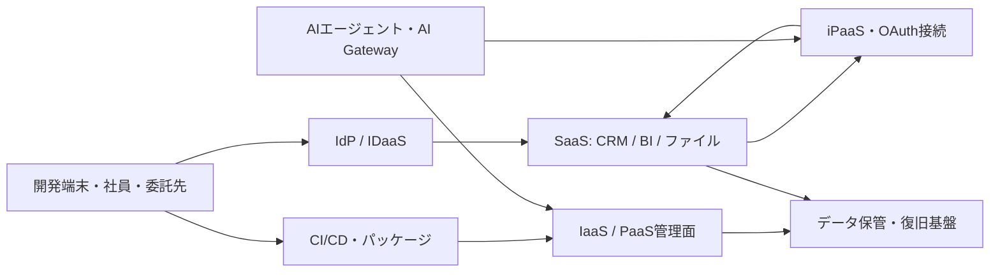

# サイバー攻撃トレンドの変遷と2027–2028年の脅威予測
**調査基準日：2026年11月20日（JST）**  
**対象：2020–2026年の世界的な攻撃手法の変化、日本国内への示唆、2027–2028年の予測**  
**用途：セキュリティ戦略・クラウド／SaaS／委託先管理・インシデント監視**

> **結論：次の主戦場は「SaaSの次に登場する一つのXaaS」ではなく、ID、OAuth、API、CI/CD、AIエージェントが結ぶサービス間の「信頼関係」そのもの。** SaaSは引き続き主要な被害の舞台だが、同時にIDaaS・iPaaS・PaaS/IaaS・AIaaS・バックアップ／復旧サービスが連動して攻撃を受ける。これは予測であり、将来の件数を保証するものではない。

## 0. 調査の読み方

- **観測済み**：公的機関、被害事業者、調査組織が確認した事実。
- **分析**：観測済み事例を比較した因果仮説。事実と区別する。
- **予測**：2026年11月20日時点での定性的見通し。「高・中・低」は調査者による**相対的な警戒度**であり、統計的な確率ではない。
- **注意点**：世界の事故統計を日本の発生率と取り違えない。侵害先がSaaS「事業者」、SaaS「顧客テナント」、SaaS「連携ベンダー」のいずれかを区別する。また「データ流出」「暗号化・停止」「可用性障害」は別の結果。
- **日本国内の事案**：個別企業名の未確認被害を根拠に予測しない。国内共通傾向はJPCERT/CC・IPAの一次報告を優先。

## 1. エグゼクティブサマリー

1. **2020–2023年：供給網／運用特権の攻撃が拡大。** ソフトウェア更新、MSPの管理基盤、IDサポート、ファイル転送ソフトを一度侵害して、多数の組織へ被害を波及させる手法が注目された。[S01][S02][S03][S04]
2. **2024–2026年：クラウド・SaaSの「顧客ID／委任権限／API」へ重心が広がる。** Snowflakeの顧客インスタンスを狙う2024年の攻撃は、プラットフォーム自体の侵害ではなく、主に盗まれた顧客資格情報を悪用。2025年のSalesloft Driftでは第三者アプリのOAuthトークンがSalesforce顧客環境へのアクセスに使われた。[S05][S06]
3. **定量的裏付けは「第三者関与の増加」。** Verizon DBIRの第三者関与割合は2024年調査15%、2025年30%、2026年48%。2026年版は2025年の事故データを主に解析。「SaaS攻撃が48%」の意味ではない。母集団・定義の違いによる年次比較の制約もある。[S07][S08]
4. **2026年時点の別の強い流れは「脆弱性悪用の高速化」。** 2026 DBIRでは脆弱性悪用が確認された情報侵害の初期侵入経路の31%、資格情報悪用は13%。ID攻撃だけに偏重してはいけない。[S08]
5. **次の重点は「非人間IDと自動化された権限」。** SaaS連携のOAuthトークン、CI/CDのOIDC信頼設定、iPaaS連携、AIエージェントのツール権限、復旧用管理基盤。正規のAPI呼び出しに見える攻撃が増えるリスク。[S09][S10][S11]
6. **国内ではWeb/APIへの攻撃も現実の重要課題。** JPCERT/CCは2026年10月、Androidアプリの解析からAPIを特定して脆弱性を検証する事例、および攻撃者によるAI利用の痕跡を報告。国内の全攻撃がSaaSに集中している証拠ではない。[S12][S13]

## 2. 2020–2026年の攻撃進化：時系列

| 時期 | 代表事案・公的／一次調査 | 侵害された「信頼」 | 今への影響 |
|---|---|---|---|
| 2020 | SolarWinds Orionの改ざんされた更新経路 [S01] | 正規ソフトウェア供給・更新 | ベンダー製品やビルド基盤が攻撃の起点になり得る |
| 2021 | Kaseya VSAを通じたMSP顧客へのランサム攻撃 [S02] | 集中運用・遠隔管理権限 | 一つの運用基盤の侵害で多数の顧客に波及 |
| 2022 | Oktaの委託サポート担当者の環境に関する侵害調査 [S03] | ID事業者のサポート／委託先 | 製品そのもの以外の特権アクセスも重要 |
| 2023 | MOVEit Transferのゼロデイ脆弱性悪用 [S04] | ファイル交換・データ集約地点 | 大量データを持つ中継機能が標的。MOVEitは必ずしもSaaSではない |
| 2024 | Snowflake**顧客アカウント**に対する資格情報悪用 [S05] | 顧客テナント認証とMFA管理 | データ基盤は「事業者が破られなくても」顧客設定の弱点で被害 |
| 2025 | Salesloft DriftとSalesforce連携のOAuthトークン悪用 [S06] | 正規アプリ連携・委任されたAPI権限 | 認証済みの連携先から顧客データの広域取得が可能 |
| 2026 | MicrosoftによるSaaS OAuth攻撃の整理、GoogleによるCI/CD→クラウド権限の横展開調査 [S09][S10] | SaaS横断のID・API・ワークロードID | ログイン画面だけ見ても侵害を検知しづらい |
| 2026 日本 | JPCERT/CCの国内連続不正アクセスとWeb/API攻撃調査 [S12][S13] | 公開API、アプリ解析、脆弱性 | SaaSに限定せず、Web、API、BIツール、モバイル連携を守る必要 |

**解釈**：攻撃対象が「オンプレ→SaaSへ一方向に置き換わった」のではない。従来のVPN・端末・脆弱性・ランサムに、供給網とID／API攻撃が**追加され、相互接続した**という理解が正確。

## 3. なぜ今、SaaS経由の被害が目立つのか

### 3.1 規模の経済
一つのSaaS連携ツールが数百〜数千の顧客テナントと接続していれば、そのツールの認証情報を盗むことで攻撃が多対一から一対多になる。これは供給網攻撃のクラウド版。[S06][S09]

### 3.2 データの集中
CRM、チケット、チャット、採用、BI、医療・金融の業務SaaSには、機微情報や認証情報が集まる。大量取得・恐喝が成立しやすい。一方「同じSaaS利用者全員が被害者」ではない。

### 3.3 境界の変化
従来のファイアウォールでは、社内ユーザーが正規OAuth同意を与えたアプリ、APIトークン、サービスアカウントによる呼び出しは見分けにくい。MFAだけでは盗まれたセッション・トークンや承認済みアプリの過剰権限に対処できない。[S09][S14]

### 3.4 事業者／顧客／連携先の責任が分かれる
- **事業者そのものの侵害**：供給網の鍵・トークン・運用基盤が盗まれる。
- **顧客テナントの侵害**：MFA未導入、資格情報流出、誤設定、過剰権限。
- **連携先の侵害**：iPaaS・マーケティング／分析ツールが正規連携で別SaaSにアクセス。
- **APIの脆弱性悪用**：Web/API自体に欠陥があり認証回避・権限不備・SQLインジェクション等から侵入。
 
Snowflakeは顧客認証の事例、Salesloft Driftは連携トークン悪用の事例。両者を単に「SaaS企業がハッキングされた」と表現すると原因を誤る。[S05][S06]

### 3.5 犯罪の分業と高速化
フィッシング、資格情報流通、初期アクセス売買、RaaS（Ransomware-as-a-Service）が被害拡大を助ける。ただし**RaaSは攻撃者のビジネスモデル**であり、ここで比較するIaaS／SaaSと同列の「被害対象サービス種別」ではない。[S15]

## 4. 2027–2028年：どの「as-a-Service」が狙われるか

> 以下は**予測**。すでに攻撃実績のある領域を含む。順位は「2026年時点の監視優先度」であり、被害件数ランキングではない。

| 領域 | 定義／例 | 主要な攻撃面 | 被害の広がり | 相対警戒度 | 根拠 |
|---|---|---|---|---|---|
| **IDaaS** | Entra ID、OktaなどのID／SSO基盤 | 特権ID、セッション、連携アプリ、条件付きアクセス | 複数SaaSへの同時侵入 | **非常に高** | ID基盤は複数業務システムの共通制御点 [S03][S09] |
| **iPaaS / 連携SaaS** | ETL・ワークフロー・API連携 | OAuth委任、コネクタ、長期トークン、Webhook | 正規API経由の大規模データ持ち出し | **非常に高** | Salesloft型の実績 [S06][S09] |
| **CI/CDaaS・開発基盤** | GitHub Actions、ビルド・デプロイ | OIDC信頼、Secrets、依存パッケージ、成果物 | クラウド管理権限・ソフト供給網への波及 | **高** | CI/CD→クラウド権限悪用の実例 [S10] |
| **IaaS / PaaS** | AWS、Azure、GCP上の利用者環境 | IAM、公開管理面、ソフトウェア脆弱性、Kubernetes | ワークロード停止、データ・鍵の窃取、破壊 | **高（既存脅威が継続）** | 2026年も脆弱性悪用が主要経路 [S08][S10] |
| **BaaS/DRaaS・仮想基盤** | Backup/Disaster Recovery-as-a-Service、ハイパーバイザー管理 | 復旧権限、Vault、スナップショット削除、暗号化 | **復旧不能化**と業務停止 | **高** | バックアップ・仮想基盤を狙うランサム攻撃 [S11] |
| **AIaaS / Agent-as-a-Service** | LLM API、AI Gateway、業務エージェント、ツール／MCP連携 | プロンプトインジェクション、ツール権限、APIキー、データ接続 | 無断データ取得・送信、承認外操作、クラウド横展開 | **高（急成長・不確実性あり）** | AIミドルウェア脆弱性・エージェント脅威モデル [S16][S17] |
| **DaaS / 分析SaaS** | データ分析基盤、DWH、CRMデータ集約 | API、クエリ権限、データ共有、認証 | 大量情報流出・恐喝 | **高** | Snowflake顧客事例 [S05] |
| **MSP / SecaaS / MDR** | 運用・監視・リモート管理サービス | 共通管理者、リモート実行、顧客接続 | 顧客横断の横展開・監視妨害 | **高** | Kaseya型の供給網攻撃 [S02] |

**補足**：「BaaS」は文脈によりBackend-as-a-Serviceを意味する場合がある。本表は**Backup-as-a-Service**を指す。またSaaS／PaaS／IaaSの分類はクラウド提供モデル、iPaaS・IDaaS・AIaaS等は用途別の通称であり、相互排他的な分類ではない。

### 有望な脅威シナリオ（推測）

**シナリオA｜IDaaS・SaaS連携チェーン（2027年まで：高警戒）**  
社員・委託先への音声フィッシング → 悪意あるOAuthアプリ同意／セッション奪取 → CRM・ファイル保管・BIへの正規APIアクセス → データ窃取。従来型マルウェアが見つからない場合もある。[S09]

**シナリオB｜CI/CD・ワークロードIDからIaaS管理面（2027年まで：高警戒）**  
開発端末／依存関係／CI/CDを侵害 → OIDC信頼や秘密情報を悪用 → クラウド管理権限を獲得 → ストレージ・データベース・バックアップに波及。GitHubやAWSそのものの侵害とは限らない。[S10]

**シナリオC｜AIエージェントによる越権操作（2027–2028年：中〜高警戒・不確実性大）**  
社外文書・検索結果・Issue等への悪意ある指示混入 → エージェントがツール／MCP経由で機密データ検索や送信を試みる → 過剰権限があると被害化。**AIによる大規模被害が必ず起きると断定できない**。AIが攻撃を加速させる現象と、AIエージェント自体が侵害面になる現象を分ける。[S16][S17][S18]

**シナリオD｜バックアップ管理面の破壊（既に観測・継続）**  
管理者／ハイパーバイザー／クラウド管理権限を奪取 → 復旧ポイント・ログ・スナップショットを削除／暗号化 → 侵害端末を戻しても復旧できない。[S11]

## 5. 攻撃面を一枚で理解する

**重要なのはノードだけではなく矢印＝委任関係・権限継承**。防御では「誰がログインできるか」だけでなく「どのアプリ／サービスアカウントが何のデータへ、どの権限で、どれだけの量を読み出せるか」を可視化する。

## 6. 国内の実務にどう落とすか（銀行・AWS・業務SaaSに共通）

### 0〜30日：侵害の入口・影響範囲を把握
1. 組織管理下のSaaS・iPaaS・IdP・外部委託先・業務API・AIツールの一覧化。管理者・担当部署・契約・データ種別・保存先・外部連携を記録。
2. OAuth Connected Apps、サービスプリンシパル、APIキー、GitHub Actions OIDC連携、AWS IAM Roles、長期アクセスキーの棚卸し。**人のIDだけでは不十分**。
3. 管理者と高リスク操作にフィッシング耐性の高いMFA（FIDO2など）、最小権限、条件付きアクセスを優先。
4. 公開Web/API、BIツール、モバイルAPI、未修正の第三者ソフトの露出評価。JPCERT/CCの注意喚起対象を優先確認。[S12][S13]
5. 復旧用管理者、バックアップ保管先、ログ保全先が本番のID侵害から連鎖破壊されないか検証。

### 31〜90日：横断検知と封じ込め
1. IdP認証イベント＋OAuth同意＋SaaS API操作＋クラウド監査ログ＋開発／CI/CDログを統合し、同一ID・アプリID・トークン単位で関連付ける。
2. バルクエクスポート、権限付与、長期トークン利用、異常なAPI頻度、深夜の自動化変更、稀な地理・端末からの管理操作を監視。
3. インシデント演習：「業務SaaS連携アプリのトークン漏えい」「CI/CD→AWS管理権限」「バックアップ削除」を個別に実施。
4. 委託先の事故通知SLA、フォレンジック証跡、サブプロセッサー、トークン失効手段を契約・運用で確認。

### 91〜180日：設計変更
1. JIT／短期トークン、OIDCワークロードID、狭いOAuthスコープ、鍵の自動ローテーションへ移行。
2. バックアップ保管に不変性、独立認証、削除猶予、クロスアカウント／クロスリージョン保護を検討。**バックアップ作成成功率でなく復元成功率**をKPI化。
3. AIエージェントは機密データ参照・送信・設定変更を権限分離し、高影響操作に人間の承認を要求。外部コンテンツを命令として無条件に実行させない。

### 推奨管理指標（初期値は自社で設定）
| KPI | 見たいリスク |
|---|---|
| 外部連携アプリ・非人間IDのオーナー設定率 | シャドー連携・放置アカウント |
| 特権トークンの最終利用日／有効期間／権限スコープ | 盗難後の継続利用 |
| 重要SaaSのAPI操作ログ取得率・保管日数 | 侵害の可視性 |
| 公開API・BIツールの重大脆弱性修正時間 | 自動探索・高速悪用 |
| 復元テスト成功率、RTO/RPO達成率 | 復旧妨害 |
| SaaS接続元の異常API取得量に対する検知時間 | 静かな大量流出 |

## 7. 反証可能な監視仮説（今後12カ月）

- **H1**：第三者のOAuth／サービスアカウント悪用が、報告される大規模SaaSデータ窃取で継続的に目立つ。**反証例**：新規事案の大半が純粋なアプリ脆弱性悪用で連携トークンを伴わない。
- **H2**：AI・iPaaS・CI/CDの「非人間ID」がインシデント調査の重要証跡になる。**反証例**：これらの連携に起因した公表被害が拡大せず、制御・隔離が容易に実装される。
- **H3**：ランサムウェアではデータ暗号化だけでなく「復旧妨害」が引き続き重視される。**反証例**：復旧基盤分離が普及し、攻撃者が別の収益化へ広く転換。
- **H4**：日本ではクラウド連携と並行して、モバイルアプリ由来の公開API・BI製品の脆弱性が大規模流出の原因として残る。[S12][S13]

毎月、被害組織の公表、JPCERT/CC、IPA、主要IR調査、KEVを確認し、「入口：人／資格情報／API脆弱性／供給網」「横展開：ID／OAuth／CI/CD」「影響：流出／停止／復旧妨害」で同一事件を一件として分類する。**公表件数の増加＝攻撃発生率の増加とは限らない**ため、観測・報告バイアスにも注意。

## 8. 一次情報・主要資料（確認日：2026-11-20）

[S01] CISA, *SolarWinds Orion compromise* (2020): https://content.govdelivery.com/accounts/USDHSCISA/bulletins/2b1b32d  
[S02] CISA, *Kaseya VSA Supply-Chain Ransomware Attack* (2021): https://content.govdelivery.com/accounts/USDHSCISA/bulletins/2e6a462  
[S03] Okta, *Investigation of the January 2022 Compromise*: https://www.okta.com/blog/company-and-culture/oktas-investigation-of-the-january-2022-compromise/  
[S04] CISA/FBI, *MOVEit vulnerability / CL0P* (2023): https://content.govdelivery.com/accounts/USDHSCISA/bulletins/35ecb08  
[S05] Mandiant/Google, *UNC5537 targets Snowflake customer instances* (2024): https://cloud.google.com/blog/topics/threat-intelligence/unc5537-snowflake-data-theft-extortion  
[S06] Google Threat Intelligence Group, *Salesforce instances via Salesloft Drift* (2025): https://cloud.google.com/blog/topics/threat-intelligence/data-theft-salesforce-instances-via-salesloft-drift  
[S07] Verizon, *2025 DBIR release* (third-party 15%→30%): https://www.verizon.com/about/news/2025-data-breach-investigations-report  
[S08] Verizon, *2026 DBIR release* (third-party 48%; vulnerability exploitation): https://www.verizon.com/about/news/breach-industry-wide-dbir-finds  
[S09] Microsoft Security, *Defending SaaS-based applications against ShinyHunters OAuth abuse* (2026-07): https://www.microsoft.com/en-us/security/blog/2026/07/13/defending-saas-based-applications-against-shinyhunters-oauth-abuse/  
[S10] Google Cloud, *Cloud Threat Horizons H1 2026*: https://cloud.google.com/security/report/resources/cloud-threat-horizons-report-h1-2026  
[S11] Mandiant/Google, *M-Trends 2026*: https://cloud.google.com/blog/topics/threat-intelligence/m-trends-2026  
[S12] JPCERT/CC, *直近で相次いでいる国内組織における不正アクセスに関する注意喚起* (2026-10): https://www.jpcert.or.jp/at/2026/at260030.html  
[S13] JPCERT/CC Eyes, *連続不正アクセス事案の攻撃手法に関する調査* (2026-10-15): https://blogs.jpcert.or.jp/ja/2026/10/web_api_attacks.html  
[S14] IETF, *RFC 9700: Best Current Practice for OAuth 2.0 Security*: https://www.rfc-editor.org/rfc/rfc9700.html  
[S15] IPA, *情報セキュリティ10大脅威 2026* (国内組織1位ランサム、2位サプライチェーン): https://www.ipa.go.jp/security/10threats/10threats2026.html  
[S16] Google Cloud, *Vulnerability Discovery and Exploitation Trends in the AI Era* (2026-10): https://cloud.google.com/blog/topics/threat-intelligence/vulnerability-discovery-and-exploitation-trends-in-the-ai-era  
[S17] OWASP, *Top 10 for Agentic Applications for 2026*: https://genai.owasp.org/resource/owasp-top-10-for-agentic-applications-for-2026/  
[S18] Microsoft, *Digital Defense Report 2026*: https://www.microsoft.com/en-us/security/security-insider/threat-landscape/2026-digital-defense-report  

---

**主要ポイントの再掲**  
1. 「SaaSが次のXaaSへ置き換わる」という仮説より、「サービスをつなぐ委任権限が攻撃される」という仮説に強い根拠。  
2. **IDaaS／iPaaS／CI/CD／バックアップ管理面はすでに要警戒**。AIエージェントは急伸する追加の攻撃面。  
3. 国内対策では**SaaS連携の棚卸し＋Web/API脆弱性対策＋復旧能力の分離**を並走。  
4. 予測は毎月検証し、確認事実・分析・仮説を混同しない。
